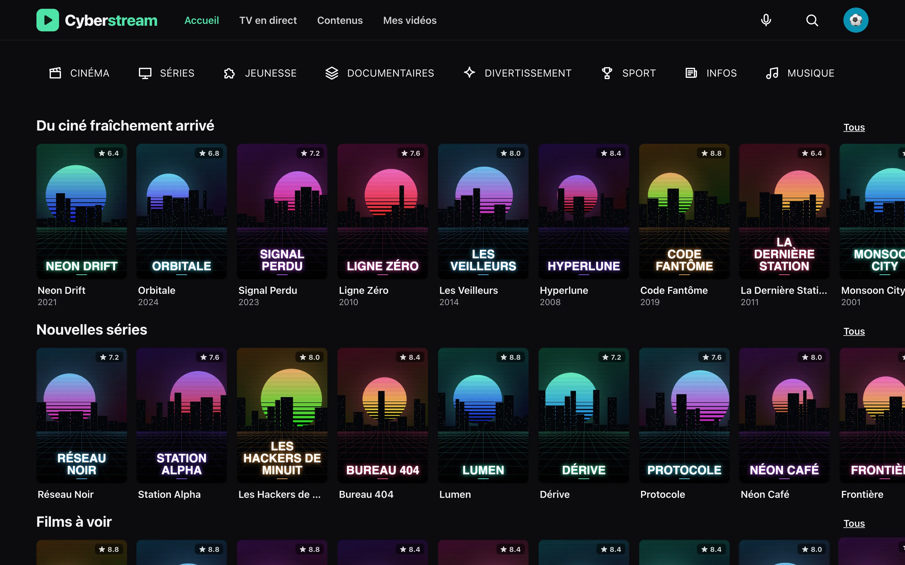
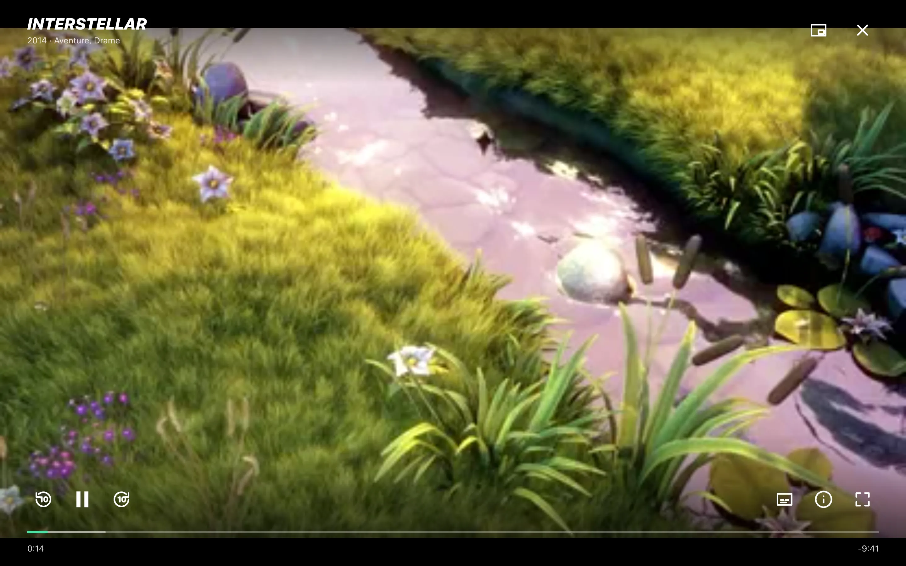

<p align="center">
  <a href="https://pickywawa.github.io/cyberstream/en/">
    
  </a>
</p>

<p align="center">
  <a href="https://github.com/pickywawa/cyberstream/releases/latest"></a>
  
  <a href="LICENSE"></a>
  
</p>

<p align="center">
  <b><a href="https://pickywawa.github.io/cyberstream/en/">Website</a></b> ·
  <b><a href="https://github.com/pickywawa/cyberstream/releases/latest">Download</a></b> ·
  <a href="#-features">Features</a> ·
  <a href="#%EF%B8%8F-screenshots">Screenshots</a> ·
  <a href="#%EF%B8%8F-build-and-test">Build</a>
  <br />
  <a href="README.md">Français</a> · <b>English</b>
</p>

---

**Cyberstream** plays your **Xtream Codes** and **M3U** sources: live channels, TV guide, movies, series and catch-up. It ports the CyberTV IPTV player to Rust: the same WebAssembly module runs in the browser, on Android phones and TVs, on iOS and in Electron. Android uses Media3 for video decoding and track selection.

> [!NOTE]
> Cyberstream is a player. It does not provide any content: you use your own sources.

<p align="center">
  
  <br />
  <sub>Recorded with the demo source and TMDB metadata. The interface is shown in French.</sub>
</p>

## ⚡ Features

| | |
| --- | --- |
| 📡 **Xtream & M3U** | Catalogues read in chunks, backup servers, differential sync. |
| 🗓️ **XMLTV guide** | Virtualised grid, “now” line, catch-up of past programmes. |
| 🎬 **Movies & series** | Pages enriched by TMDB: cast, collections, age rating, seasons, resume, next episode. |
| ⏸️ **Live pause** | Local 30 to 60 min buffer, ±10 s, back to live, automatic switch to a backup stream. |
| 🎙️ **Voice commands** | “Put on channel 5”, “search Dune”, “go back 30 seconds”, in French and English. |
| 📱 **QR code setup** | The TV gets the profile, sources and settings from your phone. |
| 🔁 **Free catch-up** | ARTE, france.tv, Okoo and YouTube RSS feeds. |
| 💬 **Subtitles & Trakt** | SRT, WebVTT, OpenSubtitles hash matching, Trakt scrobbling and watchlist. |
| 👤 **Profiles** | Avatar, language and age limit per profile. Service tokens stay in the device's secret store. |

## 🖼️ Screenshots

<table>
  <tr>
    <td width="50%"><p align="center"><sub>Home</sub></p></td>
    <td width="50%"><p align="center"><sub>Live TV</sub></p></td>
  </tr>
  <tr>
    <td><p align="center"><sub>TV guide</sub></p></td>
    <td><p align="center"><sub>Movie page</sub></p></td>
  </tr>
  <tr>
    <td><p align="center"><sub>Series</sub></p></td>
    <td><p align="center"><sub>Player — test stream <i>Big Buck Bunny</i> © Blender Foundation, CC BY</sub></p></td>
  </tr>
</table>

<p align="center">
  
  &nbsp;
  
  &nbsp;
  
</p>

## 📦 Install

Download `Cyberstream-x.y.z.apk` from the [latest release](https://github.com/pickywawa/cyberstream/releases/latest), then install it on your phone or TV:

```sh
adb -d install -r Cyberstream-1.0.1.apk
```

The Android package is `app.cyberstream.player`. The same APK installs on phones and shows up in the Android TV launcher. The declared minimum is Android 7 (API 24). The interface needs a WebView that supports WebAssembly and JavaScript modules; the system version alone does not guarantee it.

## 🦀 Porting status

The pre-release follows CyberTV 0.16.0. The port is still hybrid.

| Feature | Implementation in this version |
| --- | --- |
| Xtream and M3U sources | Rust reads catalogues in chunks, ranks entries and builds the playback and catch-up URLs. The TypeScript worker orchestrates requests, backup servers, background downloads and IndexedDB transactions. |
| XMLTV guide | Rust decompresses gzip, reads programmes, handles time zones and renders the visible cells of the grid. IndexedDB keeps the previous schedule available during an import. |
| Search and ranking | Rust indexes titles, ranks channels, detects languages and restores the catalogue index from LZ4-compressed pages. |
| Movies and series | Rust reads Xtream episodes and TMDB metadata, including age ratings, cast and collections. Rust renders page headers, seasons, episodes, the library and cards. Track selection and in-stream seek decisions also use Rust. |
| Catch-up and subtitles | Rust handles the ARTE and france.tv catalogues and streams, YouTube RSS feeds, SRT and WebVTT, and the OpenSubtitles hash. |
| Interface and remote | Main menus, profile tiles, translations, directional navigation, virtualisation and voice commands use Rust. The Trakt client, OpenSubtitles ranking and QR code exchange validation use Rust too. Home, grids, search results and Replay pages have Rust views. React and TypeScript mount screens, handle events and several service integrations. |
| Device features | Android keeps Java bridges for Media3, cache, timeshift, the secret store and TV pairing. The iOS host uses Swift and the desktop host uses Electron. |

CyberTV's screens were carried over to keep the user flows during the migration. Full parity on Android TV, iOS and desktop is still to be tested. The original specifications are in [docs/SPECIFICATIONS.md](docs/SPECIFICATIONS.md) (French).

## 🛠️ Build and test

Requirements for web and local tests: stable Rust with the WebAssembly target, Node.js 22.12 or later and npm. The bindings generator must match the crate version.

```sh
rustup target add wasm32-unknown-unknown
cargo install --locked wasm-bindgen-cli --version 0.2.108
npm ci
cargo test --locked
npm test
npm run build
```

With Android SDK 36, JDK 21, `JAVA_HOME` and `ANDROID_HOME` set:

```sh
npm run android:apk
adb -d install -r android/app/build/outputs/apk/debug/app-debug.apk
```

The profile and sources are set up on the device. To try the web version with mock data, run `npm run dev -- --host 127.0.0.1` and pick the demo source during setup. Optional service keys go in the profile settings. Since version 0.16.3, the player checks Cyberstream's GitHub releases, pre-releases included. Each Android release must attach its `update.json` manifest and the APK it references. To test another channel, set `CYBER_UPDATE_URL` to a manifest URL at build time. Users of versions 0.16.1 and 0.16.2 must install a newer APK manually once.

## 📺 Resources on Android TV

The catalogue grid keeps sorted IDs and loads posters row by visible row. The first download selects categories in the profile's audio languages, with an option to keep every language.

A fingerprint of Xtream entries keeps unchanged rows between two syncs. The guide also keeps stable slot IDs and rewrites changed programmes.

Launchers and interface icons are vector drawings. Android keeps received SVGs and animations and resizes photos for their use. The maximum edge is 224 pixels for a logo, 448 for a card and 1,024 for a hero image. Two image decodes can run at the same time. The disk cache targets 96 MiB with periodic eviction of the least recently used files.

Performance mode is on by default on Android. Home reads a bounded sample of movies. Search builds its index on demand in this mode. On a device flagged as low on memory, the player targets a 24 MiB media buffer. These limits bound specific subsystems. Total memory, start-up time and smoothness must be measured on the target TV.

## 🌐 Website

The website lives in [`docs/`](docs/) (plain HTML, CSS and JS, no build step), in French at the root and in English under `docs/en/`. It is published with GitHub Pages from the `main` branch, `/docs` folder. Local preview:

```sh
python3 -m http.server 8090 -d docs
```

## 📄 License

Code released under the [MIT](LICENSE) license.

---

<p align="center"><sub>Posters, photos and metadata: <a href="https://www.themoviedb.org/">TMDB</a>. This product uses the TMDB API but is not endorsed or certified by TMDB. Channel logos: <a href="https://github.com/iptv-org/database">iptv-org</a> database; trademarks and artwork belong to their owners. Player video: <i>Big Buck Bunny</i> test stream © Blender Foundation, CC BY 3.0.</sub></p>
