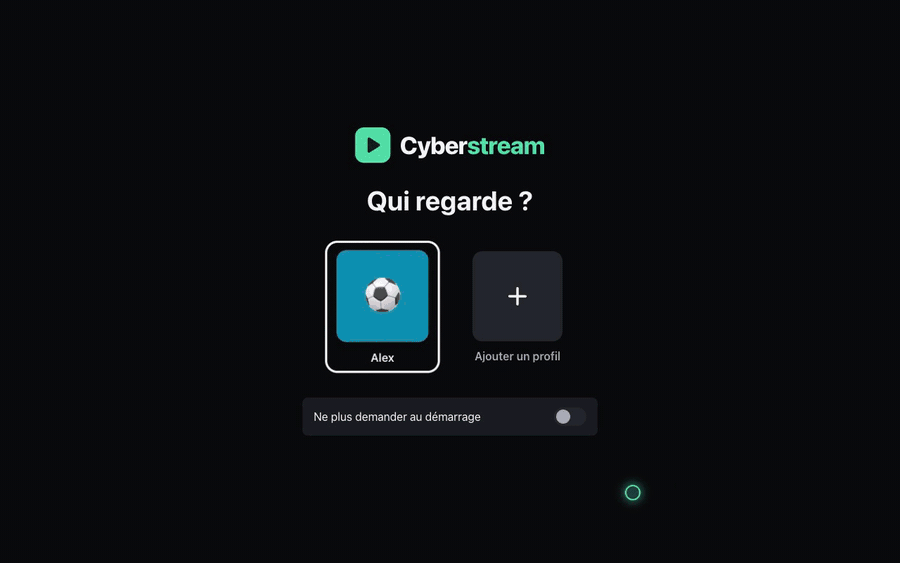
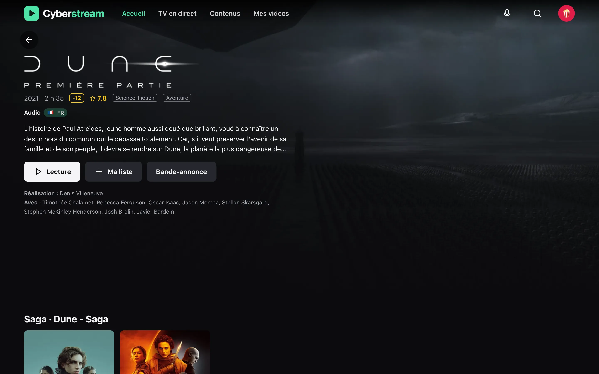

<p align="center">
  <a href="https://pickywawa.github.io/cyberstream/en/">
    
  </a>
</p>

<p align="center">
  <a href="https://github.com/pickywawa/cyberstream/releases/latest"></a>
  
  <a href="LICENSE"></a>
  
</p>

<p align="center">
  <b><a href="https://pickywawa.github.io/cyberstream/en/">Site</a></b> ·
  <b><a href="https://github.com/pickywawa/cyberstream/releases/latest">Baixar</a></b> ·
  <a href="#-fun%C3%A7%C3%B5es">Funções</a> ·
  <a href="#-idiomas-e-pa%C3%ADses">Países</a> ·
  <a href="#%EF%B8%8F-capturas">Capturas</a> ·
  <a href="#%EF%B8%8F-compilar-e-testar">Compilar</a>
  <br />
  <a href="README.md">English</a> · <a href="README.fr.md">Français</a> · <a href="README.es.md">Español</a> · <a href="README.de.md">Deutsch</a> · <a href="README.it.md">Italiano</a> · <b>Português</b> · <a href="README.ru.md">Русский</a> · <a href="README.zh.md">中文</a> · <a href="README.ja.md">日本語</a> · <a href="README.hi.md">हिन्दी</a> · <a href="README.bn.md">বাংলা</a> · <a href="README.ur.md">اردو</a> · <a href="README.ar.md">العربية</a> · <a href="README.id.md">Bahasa Indonesia</a>
</p>

---

O **Cyberstream** reproduz as suas fontes **Xtream Codes** e **M3U**: canais ao vivo, guia de TV, filmes, séries e replay. Ele porta o player IPTV CyberTV para Rust: o mesmo módulo WebAssembly roda no navegador, em celulares e TVs Android, no iOS e no Electron. O Android usa o Media3 para a decodificação de vídeo e a seleção de faixas.

> [!NOTE]
> O Cyberstream é um player. Ele não fornece nenhum conteúdo: você usa as suas próprias fontes.

<p align="center">
  
  <br />
  <sub>Gravado com a fonte de demonstração e os metadados do TMDB. A interface é mostrada em francês.</sub>
</p>

## ⚡ Funções

| | |
| --- | --- |
| 📡 **Xtream e M3U** | Catálogos lidos em blocos, servidores reserva, sincronização diferencial. |
| 🗓️ **Guia XMLTV** | Grade virtualizada, linha do “agora”, replay de programas passados. |
| 🎬 **Filmes e séries** | Páginas enriquecidas pelo TMDB: elenco, coleções, classificação etária, temporadas, retomada, próximo episódio. |
| ⏸️ **Pausa ao vivo** | Buffer local de 30 a 60 min, ±10 s, voltar ao vivo, troca automática para um stream reserva. |
| 🎙️ **Comandos de voz** | “Coloca no canal 5”, “procura Dune”, “volta 30 segundos”, nos 14 idiomas da interface. |
| 📱 **Configuração por QR code** | A TV recebe o perfil, as fontes e as configurações do seu celular. |
| 🔁 **Replay gratuito** | ARTE, france.tv, Okoo, ARD Mediathek e mais de 600 canais de veículos de mídia no YouTube, conforme os seus países. |
| 💬 **Legendas e Trakt** | SRT, WebVTT, correspondência por hash do OpenSubtitles, scrobbling e watchlist do Trakt. |
| 🌍 **14 idiomas, 42 países** | Canais gratuitos, guia de TV, rádios e placares para cada país seguido, vários países por perfil. |
| 👤 **Perfis** | Avatar, idioma e limite de idade por perfil. Os tokens dos serviços ficam no armazenamento seguro do aparelho. |

## 🌍 Idiomas e países

**Interface** em 14 idiomas: francês, inglês, alemão, espanhol, italiano, português, árabe, hindi, chinês, bengali, indonésio, urdu, russo e japonês. O árabe e o urdu são exibidos da direita para a esquerda. Os comandos de voz, as datas, o idioma das páginas do TMDB e o reconhecimento de voz seguem o idioma do perfil.

**Vários países por perfil.** No perfil, escolha um ou vários países (por exemplo, Brasil e Portugal). O primeiro é o país principal. Para cada país seguido, o aplicativo adiciona:

- **Canais gratuitos**: os streams públicos gratuitos listados pelo [iptv-org](https://github.com/iptv-org/iptv), adicionados como fonte. A opção “Canais gratuitos dos meus países” é oferecida na criação do perfil: o aplicativo funciona sem assinatura IPTV.
- **Guia de TV gratuito**: [xmltvfr.fr](https://xmltvfr.fr) para a França, [epgshare01](https://epgshare01.online) para os outros países.
- **Replay**: france.tv e Okoo (França), ARD Mediathek (Alemanha, Áustria), ARTE (em seis idiomas, na Europa).
- **YouTube**: os canais de mídia do país por tema (notícias, esporte, documentários, humor, mídia, rádio). Todos foram verificados: cada um publica pelo seu feed RSS público.
- **Rádios**: as estações mais ouvidas do país, do [Radio Browser](https://www.radio-browser.info). Todos os países são cobertos.
- **Placares ao vivo**: os campeonatos do país.

**Filtro por país.** A opção “Só os canais dos meus países” deixa de fora, no download da sua fonte, as categorias de canais de outros países (“UK|”, “DE:”, “[BE]”…). Ela é oferecida durante a configuração da fonte, antes do primeiro download.

| País | Canais gratuitos | Guia de TV | Replay | YouTube | Resultados |
| --- | --- | --- | --- | --- | --- |
| 🇫🇷 França | ≈231 (TF1, France 2, M6, Arte) | sim | france.tv, Okoo, ARTE | 21 (BFMTV, franceinfo…) | Ligue 1, Champions League, Premier League |
| 🇧🇪 Bélgica | ≈60 (La Une, Tipik, RTL-TVI, BX1) | sim | ARTE | 10 (RTBF, RTBF Info…) | Pro League, Ligue 1, Champions League |
| 🇨🇭 Suíça | ≈137 (RTS, RSI, Couleur 3, 3sat) | sim | ARTE | 9 (RTS Info, Schweizer Radio und Fernsehen…) | Super League, Ligue 1, Bundesliga |
| 🇱🇺 Luxemburgo | ≈20 (RTL, Eldo) | sim | ARTE | 2 (RTL Luxembourg, Wort…) | Ligue 1, Bundesliga, Champions League |
| 🇨🇦 Canadá | ≈265 (CBC, CTV, Télé-Québec) | sim | — | 14 (CBC News, CTV News…) | NHL, NBA, NFL |
| 🇲🇦 Marrocos | ≈13 (2M, Al Aoula, Medi1) | — | — | 10 (2MTV, Hespress…) | AFCON, Ligue 1, LaLiga |
| 🇩🇿 Argélia | ≈9 (Canal Algérie, Ennahar) | — | — | 7 (Ennahar Tv Plus, EchoroukTV…) | AFCON, Ligue 1, Champions League |
| 🇹🇳 Tunísia | ≈4 (Watania, Nessma) | — | — | 7 (Mosaique FM, Nessma TV…) | AFCON, Ligue 1, Champions League |
| 🇬🇧 Reino Unido | ≈302 (BBC One, BBC News, Channel 4) | sim | ARTE | 30 (BBC News, Sky News…) | Premier League, Champions League |
| 🇮🇪 Irlanda | ≈58 (RTÉ News, Virgin Media) | sim | ARTE | 9 (RTÉ News, The Irish Times…) | Premier Division, Premier League, Champions League |
| 🇺🇸 Estados Unidos | ≈1538 (PBS, ABC News, CBS News) | sim | — | 41 (CNN, NBC News…) | NFL, NBA, NHL |
| 🇦🇺 Austrália | ≈78 (ABC, 7, 9) | sim | — | 11 (9 News Australia, SBS News…) | AFL, A-League, Premier League |
| 🇳🇿 Nova Zelândia | ≈36 (TVNZ, Whakaata Māori) | sim | — | 6 (RNZ, 1News…) | A-League, Premier League |
| 🇩🇪 Alemanha | ≈303 (Das Erste, ZDF, 3sat, tagesschau24) | sim | ARD Mediathek, ARTE | 28 (tagesschau, ZDFheute Nachrichten…) | Bundesliga, Champions League |
| 🇦🇹 Áustria | ≈114 (ORF, ServusTV, PULS 24) | sim | ARD Mediathek, ARTE | 9 (PULS 24, Kronen Zeitung…) | Bundesliga (AT), Bundesliga, Champions League |
| 🇪🇸 Espanha | ≈305 (3Cat, À Punt, 24 Horas, Atreseries) | sim | ARTE | 27 (Antena 3 Noticias, EL PAÍS…) | LaLiga, Champions League, NBA |
| 🇲🇽 México | ≈179 (Canal 22, Canal Once, Azteca) | sim | — | 12 (NMás, MILENIO…) | Liga MX, Concacaf, LaLiga |
| 🇦🇷 Argentina | ≈224 (Telefe, TN, A24) | sim | — | 11 (C5N, LA NACION…) | Liga Profesional, Libertadores, LaLiga |
| 🇨🇴 Colômbia | ≈171 (Canal Capital, Señal Colombia) | sim | — | 7 (Noticias Caracol, Noticias RCN…) | Primera A, Libertadores, LaLiga |
| 🇨🇱 Chile | ≈220 (TVN, 24 Horas, T13) | sim | — | 9 (Teletrece, CHV Noticias…) | Primera División, Libertadores, LaLiga |
| 🇮🇹 Itália | ≈359 (Rai 1, Rai 2, Rai 3, Rai News 24) | sim | ARTE | 21 (RaiNews, Sky tg24…) | Serie A, Champions League |
| 🇵🇹 Portugal | ≈72 (RTP 1, RTP 2, RTP Notícias, SIC) | sim | — | 10 (RTP Notícias, TVI…) | Liga Portugal, Champions League |
| 🇧🇷 Brasil | ≈401 (TV Cultura, Record News, SBT) | sim | — | 23 (g1, CNN Brasil…) | Brasileirão, Libertadores, NBA |
| 🇳🇱 Países Baixos | ≈175 (NPO, AT5) | sim | — | 11 (NOS, RTL Nieuws…) | Eredivisie, Champions League |
| 🇹🇷 Turquia | ≈180 (TRT 1, TRT Haber, NTV) | sim | — | 8 (TRT Haber, CNN TÜRK…) | Süper Lig, Champions League |
| 🇵🇱 Polônia | ≈188 (TVP Info, TVP World) | sim | ARTE | 12 (tvn24, Polsat…) | Champions League |
| 🇷🇺 Rússia | ≈518 (2x2, 360°, RT) | — | — | 19 (Телеканал Дождь, BBC News - Русская служба…) | RPL |
| 🇸🇦 Arábia Saudita | ≈56 (Al Saudiya, Al Ekhbariya, Asharq News) | sim | — | 17 (AlArabiya العربية, سكاي نيوز عربية…) | Saudi Pro League, AFC Champions League, Premier League |
| 🇦🇪 Emirados Árabes Unidos | ≈23 (Dubai TV, Abu Dhabi TV) | sim | — | 10 (سكاي نيوز عربية, AlArabiya العربية…) | AFC Champions League, Premier League, LaLiga |
| 🇶🇦 Catar | ≈10 (Al Jazeera, Al Rayyan) | — | — | 4 (Al Jazeera English, العربي - أخبار…) | AFC Champions League, Premier League, LaLiga |
| 🇪🇬 Egito | ≈21 (Nile Drama, MBC Masr, Al Ghad) | — | — | 11 (CBC Egypt, Sada Elbalad - صدى البلد…) | AFCON, Premier League, LaLiga |
| 🇮🇳 Índia | ≈826 (DD National, DD News, Aaj Tak, NDTV) | sim | — | 30 (Aaj Tak, NDTV…) | ISL, Premier League |
| 🇵🇰 Paquistão | ≈105 (PTV, ARY News, Dunya News) | — | — | 19 (Geo News, ARY News…) | Premier League |
| 🇧🇩 Bangladesh | ≈37 (ATN Bangla, NTV, T Sports, Ekhon) | — | — | 17 (SOMOY TV, Jamuna TV Plus…) | Premier League |
| 🇮🇩 Indonésia | ≈177 (TVRI, Kompas TV, Metro TV) | sim | — | 28 (CNN Indonesia, tvOneNews…) | Super League, Premier League |
| 🇲🇾 Malásia | ≈6 (TV1, TV2) | sim | — | 6 (Astro AWANI, Berita Harian Online…) | Super League, Premier League |
| 🇸🇬 Singapura | ≈9 (CNA) | sim | — | 5 (CNA Insider, CNA…) | Premier League |
| 🇨🇳 China | ≈156 (CCTV-1, CCTV-4, CCTV-13) | — | — | 11 (CGTN, CCTV Video News Agency…) | CSL, NBA |
| 🇹🇼 Taiwan | ≈34 (PTS, TTV) | — | — | 10 (TVBS NEWS, SETN News Network…) | NBA, MLB |
| 🇭🇰 Hong Kong | ≈18 (RTHK, TVB) | sim | — | 7 (TVB NEWS Official 無綫新聞, RTHK 香港電台…) | Premier League, NBA |
| 🇯🇵 Japão | ≈17 (NHK General, Nippon TV, TV Asahi, Fuji TV) | sim | — | 22 (ANNnewsCH, TBS NEWS DIG Powered by JNN…) | J1 League, MLB |
| 🇰🇷 Coreia do Sul | ≈72 (KBS, MBC, Arirang) | — | — | 16 (YTN, SBS News…) | MLB, Premier League |

O número de canais gratuitos vem das listas do iptv-org no momento da redação. Alguns desses streams só funcionam no próprio país ou mudam com frequência. Alguns vídeos da ARD só podem ser vistos na Alemanha, na Áustria e na Suíça.

**Serviços não incluídos.** BBC iPlayer, ITVX e Channel 4 exigem uma conta e uma conexão a partir do Reino Unido, além de uma licença de TV para o iPlayer. A PBS passa pelo aplicativo e pela conta de cada emissora. O RTVE Play protege os seus vídeos com DRM. O RaiPlay reserva boa parte do catálogo à Itália, muitas vezes com login. Os seus canais ao vivo aparecem entre os canais gratuitos quando são transmitidos em sinal aberto, e os seus canais do YouTube estão no replay.

## 🖼️ Capturas

<table>
  <tr>
    <td width="50%"><p align="center"><sub>Início</sub></p></td>
    <td width="50%"><p align="center"><sub>TV ao vivo</sub></p></td>
  </tr>
  <tr>
    <td><p align="center"><sub>Guia de TV</sub></p></td>
    <td><p align="center"><sub>Página de filme</sub></p></td>
  </tr>
  <tr>
    <td><p align="center"><sub>Séries</sub></p></td>
    <td><p align="center"><sub>Player — stream de teste <i>Big Buck Bunny</i> © Blender Foundation, CC BY</sub></p></td>
  </tr>
</table>

<p align="center">
  
  &nbsp;
  
  &nbsp;
  
</p>

## 📦 Instalação

Baixe `Cyberstream-x.y.z.apk` da [versão mais recente](https://github.com/pickywawa/cyberstream/releases/latest) e instale no seu celular ou TV:

```sh
adb -d install -r Cyberstream-1.0.1.apk
```

O pacote Android é `app.cyberstream.player`. O mesmo APK é instalado em celulares e aparece no launcher do Android TV. O mínimo declarado é o Android 7 (API 24). A interface precisa de um WebView com suporte a WebAssembly e módulos JavaScript; só a versão do sistema não garante isso.

## 🦀 Estado da portabilidade

A pré-versão acompanha o CyberTV 0.16.0. A portabilidade ainda é híbrida.

| Função | Implementação nesta versão |
| --- | --- |
| Fontes Xtream e M3U | O Rust lê os catálogos em blocos, classifica as entradas e monta as URLs de reprodução e replay. O worker TypeScript orquestra as requisições, os servidores reserva, os downloads em segundo plano e as transações IndexedDB. |
| Guia XMLTV | O Rust descompacta gzip, lê os programas, trata os fusos horários e desenha as células visíveis da grade. O IndexedDB mantém a programação anterior disponível durante uma importação. |
| Busca e classificação | O Rust indexa os títulos, classifica os canais, detecta os idiomas e restaura o índice do catálogo a partir de páginas compactadas em LZ4. |
| Filmes e séries | O Rust lê os episódios Xtream e os metadados do TMDB, incluindo classificações etárias, elenco e coleções. O Rust desenha os cabeçalhos das páginas, temporadas, episódios, a biblioteca e os cards. A seleção de faixas e as decisões de busca no stream também usam Rust. |
| Replay e legendas | O Rust trata os catálogos e streams da ARTE e da france.tv, os feeds RSS do YouTube, SRT e WebVTT e o hash do OpenSubtitles. |
| Interface e controle remoto | Os menus principais, os blocos de perfil, as traduções, a navegação direcional, a virtualização e os comandos de voz usam Rust. O cliente Trakt, a classificação do OpenSubtitles e a validação da troca por QR code também. Início, grades, resultados de busca e páginas de Replay têm visualizações em Rust. React e TypeScript montam as telas, tratam os eventos e várias integrações de serviços. |
| Recursos do aparelho | O Android mantém pontes Java para Media3, cache, timeshift, armazenamento seguro e pareamento da TV. O host iOS usa Swift e o host desktop usa Electron. |

As telas do CyberTV foram mantidas para preservar os fluxos de uso durante a migração. A paridade completa no Android TV, iOS e desktop ainda precisa ser testada. As especificações originais estão em [docs/SPECIFICATIONS.md](docs/SPECIFICATIONS.md) (em francês).

## 🛠️ Compilar e testar

Requisitos para a web e os testes locais: Rust estável com o target WebAssembly, Node.js 22.12 ou posterior e npm. O gerador de bindings deve corresponder à versão do crate.

```sh
rustup target add wasm32-unknown-unknown
cargo install --locked wasm-bindgen-cli --version 0.2.108
npm ci
cargo test --locked
npm test
npm run build
```

Com Android SDK 36, JDK 21, `JAVA_HOME` e `ANDROID_HOME` definidos:

```sh
npm run android:apk
adb -d install -r android/app/build/outputs/apk/debug/app-debug.apk
```

O perfil e as fontes são configurados no aparelho. Para testar a versão web com dados fictícios, rode `npm run dev -- --host 127.0.0.1` e escolha a fonte de demonstração durante a configuração. As chaves de serviços opcionais ficam nas configurações do perfil. Desde a versão 0.16.3, o player verifica as releases do Cyberstream no GitHub, incluindo pré-versões. Cada release Android deve anexar o seu manifesto `update.json` e o APK que ele referencia. Para testar outro canal, defina `CYBER_UPDATE_URL` com a URL de um manifesto na compilação. Os usuários das versões 0.16.1 e 0.16.2 precisam instalar manualmente um APK mais recente uma vez.

## 📺 Recursos no Android TV

A grade do catálogo guarda IDs ordenados e carrega os pôsteres fileira por fileira conforme as fileiras visíveis. O primeiro download seleciona as categorias nos idiomas de áudio do perfil, com uma opção para manter todos os idiomas.

Uma impressão digital das entradas Xtream mantém as linhas inalteradas entre duas sincronizações. O guia também mantém IDs de faixa horária estáveis e reescreve os programas alterados.

Os ícones do launcher e da interface são desenhos vetoriais. O Android mantém os SVGs e as animações recebidos e redimensiona as fotos conforme o uso. A borda máxima é de 224 pixels para um logo, 448 para um card e 1.024 para uma imagem de destaque. Duas decodificações de imagem podem rodar ao mesmo tempo. O cache em disco mira 96 MiB com remoção periódica dos arquivos usados há mais tempo.

O modo desempenho fica ativado por padrão no Android. O início lê uma amostra limitada de filmes. Nesse modo, a busca monta o seu índice sob demanda. Num aparelho marcado como de pouca memória, o player mira um buffer de mídia de 24 MiB. Esses limites restringem subsistemas específicos. A memória total, o tempo de inicialização e a fluidez devem ser medidos na TV de destino.

## 🌐 Site

O site fica em [`docs/`](docs/) (HTML, CSS e JS simples, sem etapa de build), em francês na raiz e em inglês em `docs/en/`. É publicado com o GitHub Pages a partir do branch `main`, pasta `/docs`. Pré-visualização local:

```sh
python3 -m http.server 8090 -d docs
```

## 📄 Licença

Código publicado sob a licença [MIT](LICENSE).

---

<p align="center"><sub>Pôsteres, fotos e metadados: <a href="https://www.themoviedb.org/">TMDB</a>. Este produto usa a API do TMDB, mas não é endossado nem certificado pelo TMDB. Logos dos canais e listas de canais gratuitos: <a href="https://github.com/iptv-org">iptv-org</a>; marcas e artes pertencem aos seus donos. Guias de TV: xmltvfr.fr e epgshare01. Rádios: Radio Browser. Vídeo do player: stream de teste <i>Big Buck Bunny</i> © Blender Foundation, CC BY 3.0.</sub></p>
