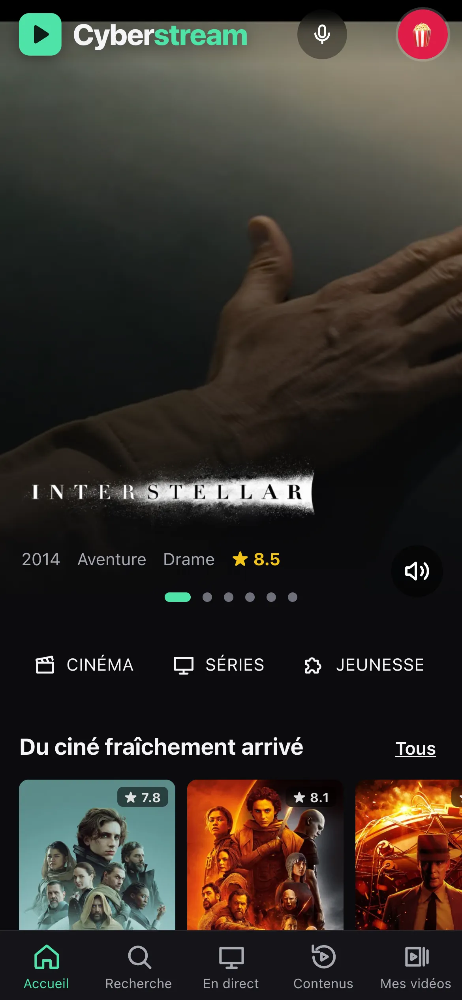

<p align="center">
  <a href="https://pickywawa.github.io/cyberstream/en/">
    
  </a>
</p>

<p align="center">
  <a href="https://github.com/pickywawa/cyberstream/releases/latest"></a>
  
  <a href="LICENSE"></a>
  
</p>

<p align="center">
  <b><a href="https://pickywawa.github.io/cyberstream/en/">Сайт</a></b> ·
  <b><a href="https://github.com/pickywawa/cyberstream/releases/latest">Скачать</a></b> ·
  <a href="#-%D0%B2%D0%BE%D0%B7%D0%BC%D0%BE%D0%B6%D0%BD%D0%BE%D1%81%D1%82%D0%B8">Возможности</a> ·
  <a href="#-%D1%8F%D0%B7%D1%8B%D0%BA%D0%B8-%D0%B8-%D1%81%D1%82%D1%80%D0%B0%D0%BD%D1%8B">Страны</a> ·
  <a href="#%EF%B8%8F-%D1%81%D0%BA%D1%80%D0%B8%D0%BD%D1%88%D0%BE%D1%82%D1%8B">Скриншоты</a> ·
  <a href="#%EF%B8%8F-%D1%81%D0%B1%D0%BE%D1%80%D0%BA%D0%B0-%D0%B8-%D1%82%D0%B5%D1%81%D1%82%D1%8B">Сборка</a>
  <br />
  <a href="README.md">English</a> · <a href="README.fr.md">Français</a> · <a href="README.es.md">Español</a> · <a href="README.de.md">Deutsch</a> · <a href="README.it.md">Italiano</a> · <a href="README.pt.md">Português</a> · <b>Русский</b> · <a href="README.zh.md">中文</a> · <a href="README.ja.md">日本語</a> · <a href="README.hi.md">हिन्दी</a> · <a href="README.bn.md">বাংলা</a> · <a href="README.ur.md">اردو</a> · <a href="README.ar.md">العربية</a> · <a href="README.id.md">Bahasa Indonesia</a>
</p>

---

**Cyberstream** воспроизводит ваши источники **Xtream Codes** и **M3U**: прямые эфиры, телегид, фильмы, сериалы и архив передач. Это порт IPTV-плеера CyberTV на Rust: один и тот же модуль WebAssembly работает в браузере, на смартфонах и телевизорах Android, на iOS и в Electron. На Android для декодирования видео и выбора дорожек используется Media3.

> [!NOTE]
> Cyberstream — это плеер. Он не предоставляет никакого контента: вы используете свои источники.

<p align="center">
  
  <br />
  <sub>Записано с демо-источником и метаданными TMDB. Интерфейс показан на французском.</sub>
</p>

## ⚡ Возможности

| | |
| --- | --- |
| 📡 **Xtream и M3U** | Каталоги читаются частями, резервные серверы, дифференциальная синхронизация. |
| 🗓️ **Телегид XMLTV** | Виртуализированная сетка, линия «сейчас», просмотр прошедших передач. |
| 🎬 **Фильмы и сериалы** | Страницы с данными TMDB: актёры, коллекции, возрастной рейтинг, сезоны, продолжение просмотра, следующая серия. |
| ⏸️ **Пауза эфира** | Локальный буфер на 30–60 мин, ±10 с, возврат в эфир, автоматическое переключение на резервный поток. |
| 🎙️ **Голосовые команды** | «Включи пятый канал», «найди Дюну», «назад на 30 секунд» — на 14 языках интерфейса. |
| 📱 **Настройка по QR-коду** | Телевизор получает профиль, источники и настройки с вашего телефона. |
| 🔁 **Бесплатный архив** | ARTE, france.tv, Okoo, ARD Mediathek и более 600 YouTube-каналов СМИ — в зависимости от ваших стран. |
| 💬 **Субтитры и Trakt** | SRT, WebVTT, подбор по хешу OpenSubtitles, скробблинг и список просмотра Trakt. |
| 🌍 **14 языков, 42 страны** | Бесплатные каналы, телегид, радио и счёт матчей для каждой выбранной страны, несколько стран в профиле. |
| 👤 **Профили** | Аватар, язык и возрастное ограничение для каждого профиля. Токены сервисов хранятся в защищённом хранилище устройства. |

## 🌍 Языки и страны

**Интерфейс** на 14 языках: французский, английский, немецкий, испанский, итальянский, португальский, арабский, хинди, китайский, бенгальский, индонезийский, урду, русский и японский. Арабский и урду отображаются справа налево. Голосовые команды, даты, язык страниц TMDB и распознавание речи следуют языку профиля.

**Несколько стран в профиле.** В профиле выберите одну или несколько стран (например, Германию и Австрию). Первая — основная. Для каждой выбранной страны приложение добавляет:

- **Бесплатные каналы**: открытые бесплатные потоки из списков [iptv-org](https://github.com/iptv-org/iptv), добавленные как источник. Опция «Бесплатные каналы моих стран» предлагается при создании профиля: приложение работает без подписки на IPTV.
- **Бесплатный телегид**: [xmltvfr.fr](https://xmltvfr.fr) для Франции, [epgshare01](https://epgshare01.online) для остальных стран.
- **Архив**: france.tv и Okoo (Франция), ARD Mediathek (Германия, Австрия), ARTE (на шести языках, в Европе).
- **YouTube**: каналы СМИ страны по темам (новости, спорт, документальное, юмор, медиа, радио). Все проверены: каждый публикует видео через свою открытую RSS-ленту.
- **Радио**: самые популярные станции страны из [Radio Browser](https://www.radio-browser.info). Охвачены все страны.
- **Счёт матчей в реальном времени**: лиги страны.

**Фильтр по странам.** Опция «Только каналы моих стран» при загрузке источника отбрасывает категории каналов других стран («UK|», «DE:», «[BE]»…). Она предлагается при настройке источника, до первой загрузки.

| Страна | Бесплатные каналы | Телегид | Архив | YouTube | Счёт матчей |
| --- | --- | --- | --- | --- | --- |
| 🇫🇷 Франция | ≈231 (TF1, France 2, M6, Arte) | да | france.tv, Okoo, ARTE | 21 (BFMTV, franceinfo…) | Ligue 1, Champions League, Premier League |
| 🇧🇪 Бельгия | ≈60 (La Une, Tipik, RTL-TVI, BX1) | да | ARTE | 10 (RTBF, RTBF Info…) | Pro League, Ligue 1, Champions League |
| 🇨🇭 Швейцария | ≈137 (RTS, RSI, Couleur 3, 3sat) | да | ARTE | 9 (RTS Info, Schweizer Radio und Fernsehen…) | Super League, Ligue 1, Bundesliga |
| 🇱🇺 Люксембург | ≈20 (RTL, Eldo) | да | ARTE | 2 (RTL Luxembourg, Wort…) | Ligue 1, Bundesliga, Champions League |
| 🇨🇦 Канада | ≈265 (CBC, CTV, Télé-Québec) | да | — | 14 (CBC News, CTV News…) | NHL, NBA, NFL |
| 🇲🇦 Марокко | ≈13 (2M, Al Aoula, Medi1) | — | — | 10 (2MTV, Hespress…) | AFCON, Ligue 1, LaLiga |
| 🇩🇿 Алжир | ≈9 (Canal Algérie, Ennahar) | — | — | 7 (Ennahar Tv Plus, EchoroukTV…) | AFCON, Ligue 1, Champions League |
| 🇹🇳 Тунис | ≈4 (Watania, Nessma) | — | — | 7 (Mosaique FM, Nessma TV…) | AFCON, Ligue 1, Champions League |
| 🇬🇧 Великобритания | ≈302 (BBC One, BBC News, Channel 4) | да | ARTE | 30 (BBC News, Sky News…) | Premier League, Champions League |
| 🇮🇪 Ирландия | ≈58 (RTÉ News, Virgin Media) | да | ARTE | 9 (RTÉ News, The Irish Times…) | Premier Division, Premier League, Champions League |
| 🇺🇸 Соединенные Штаты | ≈1538 (PBS, ABC News, CBS News) | да | — | 41 (CNN, NBC News…) | NFL, NBA, NHL |
| 🇦🇺 Австралия | ≈78 (ABC, 7, 9) | да | — | 11 (9 News Australia, SBS News…) | AFL, A-League, Premier League |
| 🇳🇿 Новая Зеландия | ≈36 (TVNZ, Whakaata Māori) | да | — | 6 (RNZ, 1News…) | A-League, Premier League |
| 🇩🇪 Германия | ≈303 (Das Erste, ZDF, 3sat, tagesschau24) | да | ARD Mediathek, ARTE | 28 (tagesschau, ZDFheute Nachrichten…) | Bundesliga, Champions League |
| 🇦🇹 Австрия | ≈114 (ORF, ServusTV, PULS 24) | да | ARD Mediathek, ARTE | 9 (PULS 24, Kronen Zeitung…) | Bundesliga (AT), Bundesliga, Champions League |
| 🇪🇸 Испания | ≈305 (3Cat, À Punt, 24 Horas, Atreseries) | да | ARTE | 27 (Antena 3 Noticias, EL PAÍS…) | LaLiga, Champions League, NBA |
| 🇲🇽 Мексика | ≈179 (Canal 22, Canal Once, Azteca) | да | — | 12 (NMás, MILENIO…) | Liga MX, Concacaf, LaLiga |
| 🇦🇷 Аргентина | ≈224 (Telefe, TN, A24) | да | — | 11 (C5N, LA NACION…) | Liga Profesional, Libertadores, LaLiga |
| 🇨🇴 Колумбия | ≈171 (Canal Capital, Señal Colombia) | да | — | 7 (Noticias Caracol, Noticias RCN…) | Primera A, Libertadores, LaLiga |
| 🇨🇱 Чили | ≈220 (TVN, 24 Horas, T13) | да | — | 9 (Teletrece, CHV Noticias…) | Primera División, Libertadores, LaLiga |
| 🇮🇹 Италия | ≈359 (Rai 1, Rai 2, Rai 3, Rai News 24) | да | ARTE | 21 (RaiNews, Sky tg24…) | Serie A, Champions League |
| 🇵🇹 Португалия | ≈72 (RTP 1, RTP 2, RTP Notícias, SIC) | да | — | 10 (RTP Notícias, TVI…) | Liga Portugal, Champions League |
| 🇧🇷 Бразилия | ≈401 (TV Cultura, Record News, SBT) | да | — | 23 (g1, CNN Brasil…) | Brasileirão, Libertadores, NBA |
| 🇳🇱 Нидерланды | ≈175 (NPO, AT5) | да | — | 11 (NOS, RTL Nieuws…) | Eredivisie, Champions League |
| 🇹🇷 Турция | ≈180 (TRT 1, TRT Haber, NTV) | да | — | 8 (TRT Haber, CNN TÜRK…) | Süper Lig, Champions League |
| 🇵🇱 Польша | ≈188 (TVP Info, TVP World) | да | ARTE | 12 (tvn24, Polsat…) | Champions League |
| 🇷🇺 Россия | ≈518 (2x2, 360°, RT) | — | — | 19 (Телеканал Дождь, BBC News - Русская служба…) | RPL |
| 🇸🇦 Саудовская Аравия | ≈56 (Al Saudiya, Al Ekhbariya, Asharq News) | да | — | 17 (AlArabiya العربية, سكاي نيوز عربية…) | Saudi Pro League, AFC Champions League, Premier League |
| 🇦🇪 ОАЭ | ≈23 (Dubai TV, Abu Dhabi TV) | да | — | 10 (سكاي نيوز عربية, AlArabiya العربية…) | AFC Champions League, Premier League, LaLiga |
| 🇶🇦 Катар | ≈10 (Al Jazeera, Al Rayyan) | — | — | 4 (Al Jazeera English, العربي - أخبار…) | AFC Champions League, Premier League, LaLiga |
| 🇪🇬 Египет | ≈21 (Nile Drama, MBC Masr, Al Ghad) | — | — | 11 (CBC Egypt, Sada Elbalad - صدى البلد…) | AFCON, Premier League, LaLiga |
| 🇮🇳 Индия | ≈826 (DD National, DD News, Aaj Tak, NDTV) | да | — | 30 (Aaj Tak, NDTV…) | ISL, Premier League |
| 🇵🇰 Пакистан | ≈105 (PTV, ARY News, Dunya News) | — | — | 19 (Geo News, ARY News…) | Premier League |
| 🇧🇩 Бангладеш | ≈37 (ATN Bangla, NTV, T Sports, Ekhon) | — | — | 17 (SOMOY TV, Jamuna TV Plus…) | Premier League |
| 🇮🇩 Индонезия | ≈177 (TVRI, Kompas TV, Metro TV) | да | — | 28 (CNN Indonesia, tvOneNews…) | Super League, Premier League |
| 🇲🇾 Малайзия | ≈6 (TV1, TV2) | да | — | 6 (Astro AWANI, Berita Harian Online…) | Super League, Premier League |
| 🇸🇬 Сингапур | ≈9 (CNA) | да | — | 5 (CNA Insider, CNA…) | Premier League |
| 🇨🇳 Китай | ≈156 (CCTV-1, CCTV-4, CCTV-13) | — | — | 11 (CGTN, CCTV Video News Agency…) | CSL, NBA |
| 🇹🇼 Тайвань | ≈34 (PTS, TTV) | — | — | 10 (TVBS NEWS, SETN News Network…) | NBA, MLB |
| 🇭🇰 Гонконг | ≈18 (RTHK, TVB) | да | — | 7 (TVB NEWS Official 無綫新聞, RTHK 香港電台…) | Premier League, NBA |
| 🇯🇵 Япония | ≈17 (NHK General, Nippon TV, TV Asahi, Fuji TV) | да | — | 22 (ANNnewsCH, TBS NEWS DIG Powered by JNN…) | J1 League, MLB |
| 🇰🇷 Республика Корея | ≈72 (KBS, MBC, Arirang) | — | — | 16 (YTN, SBS News…) | MLB, Premier League |

Число бесплатных каналов взято из списков iptv-org на момент написания. Некоторые из этих потоков работают только в своей стране или часто меняются. Часть видео ARD доступна только в Германии, Австрии и Швейцарии.

**Сервисы, которые не поддерживаются.** BBC iPlayer, ITVX и Channel 4 требуют учётной записи и подключения из Великобритании, а для iPlayer ещё и телевизионной лицензии. PBS работает через приложение и учётную запись каждой станции. RTVE Play защищает видео с помощью DRM. RaiPlay ограничивает большую часть каталога Италией, часто со входом в аккаунт. Их прямые эфиры появляются среди бесплатных каналов, если транслируются в открытом доступе, а их YouTube-каналы есть в архиве.

## 🖼️ Скриншоты

<table>
  <tr>
    <td width="50%"><p align="center"><sub>Главная</sub></p></td>
    <td width="50%"><p align="center"><sub>Прямой эфир</sub></p></td>
  </tr>
  <tr>
    <td><p align="center"><sub>Телегид</sub></p></td>
    <td><p align="center"><sub>Страница фильма</sub></p></td>
  </tr>
  <tr>
    <td><p align="center"><sub>Сериалы</sub></p></td>
    <td><p align="center"><sub>Плеер — тестовый поток <i>Big Buck Bunny</i> © Blender Foundation, CC BY</sub></p></td>
  </tr>
</table>

<p align="center">
  
  &nbsp;
  
  &nbsp;
  
</p>

## 📦 Установка

Скачайте `Cyberstream-x.y.z.apk` из [последнего релиза](https://github.com/pickywawa/cyberstream/releases/latest) и установите на телефон или телевизор:

```sh
adb -d install -r Cyberstream-1.0.1.apk
```

Пакет Android — `app.cyberstream.player`. Один и тот же APK устанавливается на телефоны и появляется в лаунчере Android TV. Заявленный минимум — Android 7 (API 24). Интерфейсу нужен WebView с поддержкой WebAssembly и модулей JavaScript; одна лишь версия системы этого не гарантирует.

## 🦀 Состояние портирования

Предварительная версия соответствует CyberTV 0.16.0. Порт пока гибридный.

| Функция | Реализация в этой версии |
| --- | --- |
| Источники Xtream и M3U | Rust читает каталоги частями, ранжирует записи и строит URL для воспроизведения и архива. Воркер на TypeScript управляет запросами, резервными серверами, фоновыми загрузками и транзакциями IndexedDB. |
| Телегид XMLTV | Rust распаковывает gzip, читает передачи, учитывает часовые пояса и отрисовывает видимые ячейки сетки. IndexedDB сохраняет доступной прежнюю программу во время импорта. |
| Поиск и ранжирование | Rust индексирует названия, ранжирует каналы, определяет языки и восстанавливает индекс каталога из страниц, сжатых LZ4. |
| Фильмы и сериалы | Rust читает серии Xtream и метаданные TMDB, включая возрастные рейтинги, актёров и коллекции. Rust отрисовывает заголовки страниц, сезоны, серии, библиотеку и карточки. Выбор дорожек и решения о перемотке внутри потока тоже на Rust. |
| Архив и субтитры | Rust обрабатывает каталоги и потоки ARTE и france.tv, RSS-ленты YouTube, SRT и WebVTT, а также хеш OpenSubtitles. |
| Интерфейс и пульт | Главные меню, плитки профилей, переводы, навигация стрелками, виртуализация и голосовые команды на Rust. Клиент Trakt, ранжирование OpenSubtitles и проверка обмена по QR-коду — тоже. Главная, сетки, результаты поиска и страницы Replay имеют представления на Rust. React и TypeScript монтируют экраны, обрабатывают события и ряд интеграций с сервисами. |
| Функции устройства | Android сохраняет Java-мосты для Media3, кеша, timeshift, защищённого хранилища и сопряжения с ТВ. Хост iOS написан на Swift, настольный — на Electron. |

Экраны CyberTV перенесены, чтобы сохранить пользовательские сценарии во время миграции. Полный паритет на Android TV, iOS и десктопе ещё предстоит проверить. Исходные спецификации — в [docs/SPECIFICATIONS.md](docs/SPECIFICATIONS.md) (на французском).

## 🛠️ Сборка и тесты

Требования для веба и локальных тестов: стабильный Rust с целью WebAssembly, Node.js 22.12 или новее и npm. Генератор привязок должен совпадать с версией crate.

```sh
rustup target add wasm32-unknown-unknown
cargo install --locked wasm-bindgen-cli --version 0.2.108
npm ci
cargo test --locked
npm test
npm run build
```

С Android SDK 36, JDK 21 и заданными `JAVA_HOME` и `ANDROID_HOME`:

```sh
npm run android:apk
adb -d install -r android/app/build/outputs/apk/debug/app-debug.apk
```

Профиль и источники настраиваются на устройстве. Чтобы попробовать веб-версию с тестовыми данными, запустите `npm run dev -- --host 127.0.0.1` и выберите демо-источник при настройке. Необязательные ключи сервисов задаются в настройках профиля. Начиная с версии 0.16.3 плеер проверяет релизы Cyberstream на GitHub, включая предварительные. Каждый релиз для Android должен содержать свой манифест `update.json` и APK, на который он ссылается. Чтобы проверить другой канал, задайте при сборке `CYBER_UPDATE_URL` с URL манифеста. Пользователям версий 0.16.1 и 0.16.2 нужно один раз вручную установить более новый APK.

## 📺 Ресурсы на Android TV

Сетка каталога хранит отсортированные идентификаторы и загружает постеры построчно по видимым рядам. Первая загрузка выбирает категории на языках аудио профиля, с возможностью оставить все языки.

Отпечаток записей Xtream сохраняет неизменённые строки между двумя синхронизациями. Телегид тоже сохраняет стабильные идентификаторы слотов и перезаписывает изменённые передачи.

Значки лаунчера и интерфейса — векторные рисунки. Android сохраняет полученные SVG и анимации и масштабирует фотографии под их назначение. Максимальная сторона — 224 пикселя для логотипа, 448 для карточки и 1024 для обложки. Одновременно могут выполняться два декодирования изображений. Дисковый кеш рассчитан на 96 МиБ с периодическим удалением давно не использованных файлов.

Режим производительности на Android включён по умолчанию. Главная читает ограниченную выборку фильмов. В этом режиме поиск строит индекс по запросу. На устройстве с пометкой «мало памяти» плеер ориентируется на медиабуфер в 24 МиБ. Эти ограничения касаются отдельных подсистем. Общий расход памяти, время запуска и плавность нужно измерять на целевом телевизоре.

## 🌐 Сайт

Сайт находится в [`docs/`](docs/) (чистые HTML, CSS и JS, без сборки): на французском в корне и на английском в `docs/en/`. Он публикуется через GitHub Pages из ветки `main`, папка `/docs`. Локальный просмотр:

```sh
python3 -m http.server 8090 -d docs
```

## 📄 Лицензия

Код распространяется по лицензии [MIT](LICENSE).

---

<p align="center"><sub>Постеры, фото и метаданные: <a href="https://www.themoviedb.org/">TMDB</a>. Этот продукт использует API TMDB, но не одобрен и не сертифицирован TMDB. Логотипы каналов и списки бесплатных каналов: <a href="https://github.com/iptv-org">iptv-org</a>; товарные знаки и изображения принадлежат их владельцам. Телегиды: xmltvfr.fr и epgshare01. Радио: Radio Browser. Видео в плеере: тестовый поток <i>Big Buck Bunny</i> © Blender Foundation, CC BY 3.0.</sub></p>
