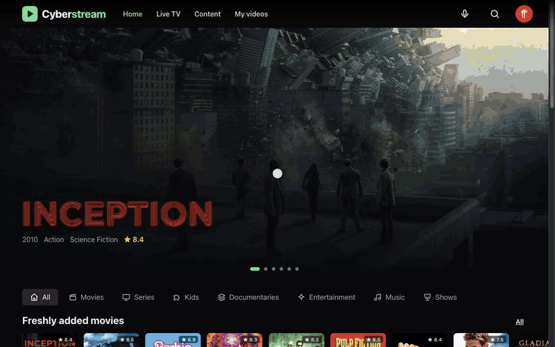
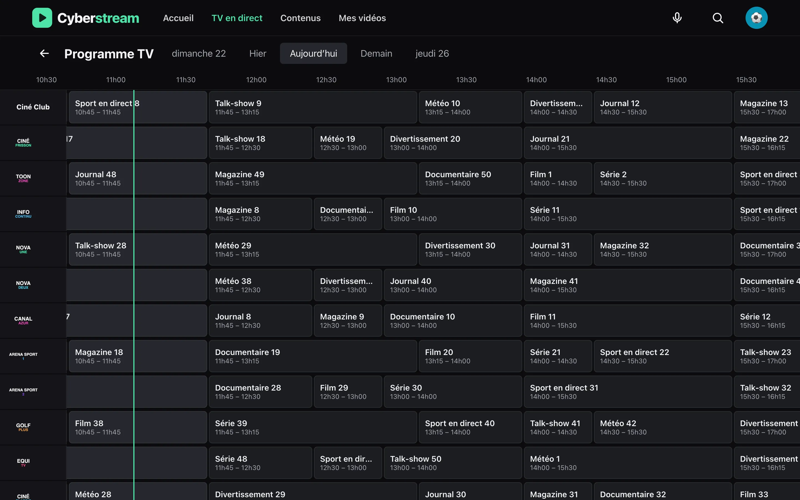

<p align="center">
  <a href="https://pickywawa.github.io/cyberstream/en/">
    
  </a>
</p>

<p align="center">
  <a href="https://github.com/pickywawa/cyberstream/releases/latest"></a>
  
  <a href="../../LICENSE"></a>
  
</p>

<p align="center">
  <b><a href="https://pickywawa.github.io/cyberstream/en/">الموقع</a></b> ·
  <b><a href="https://github.com/pickywawa/cyberstream/releases/latest">تنزيل</a></b> ·
  <a href="#-%D8%A7%D9%84%D9%85%D9%8A%D8%B2%D8%A7%D8%AA">الميزات</a> ·
  <a href="#-%D8%A7%D9%84%D9%84%D8%BA%D8%A7%D8%AA-%D9%88%D8%A7%D9%84%D8%A8%D9%84%D8%AF%D8%A7%D9%86">البلدان</a> ·
  <a href="#%EF%B8%8F-%D9%84%D9%82%D8%B7%D8%A7%D8%AA-%D8%A7%D9%84%D8%B4%D8%A7%D8%B4%D8%A9">لقطات الشاشة</a> ·
  <a href="#%EF%B8%8F-%D8%A7%D9%84%D8%A8%D9%86%D8%A7%D8%A1-%D9%88%D8%A7%D9%84%D8%A7%D8%AE%D8%AA%D8%A8%D8%A7%D8%B1">البناء</a>
  <br />
  <a href="../../README.md">English</a> · <a href="README.fr.md">Français</a> · <a href="README.es.md">Español</a> · <a href="README.de.md">Deutsch</a> · <a href="README.it.md">Italiano</a> · <a href="README.pt.md">Português</a> · <a href="README.ru.md">Русский</a> · <a href="README.zh.md">中文</a> · <a href="README.ja.md">日本語</a> · <a href="README.hi.md">हिन्दी</a> · <a href="README.bn.md">বাংলা</a> · <a href="README.ur.md">اردو</a> · <b>العربية</b> · <a href="README.id.md">Bahasa Indonesia</a>
</p>

---

<div dir="rtl">

يشغّل **Cyberstream** مصادرك من **Xtream Codes** و**M3U**: القنوات المباشرة ودليل البرامج والأفلام والمسلسلات وإعادة المشاهدة. وهو نقلٌ لمشغّل IPTV ‏CyberTV إلى Rust: تعمل وحدة WebAssembly نفسها في المتصفح وعلى هواتف وتلفزيونات Android وعلى iOS وفي Electron. يستخدم Android مكتبة Media3 لفك ترميز الفيديو واختيار المسارات.

> [!NOTE]
> Cyberstream مجرد مشغّل. لا يوفّر أي محتوى: أنت تستخدم مصادرك الخاصة.

<p align="center">
  
  <br />
  <sub>مسجّل باستخدام المصدر التجريبي وبيانات TMDB. الواجهة معروضة بالإنجليزية.</sub>
</p>

## ⚡ الميزات

| | |
| --- | --- |
| 📡 **Xtream وM3U** | قراءة الكتالوجات على دفعات، خوادم احتياطية، مزامنة تفاضلية. |
| 🗓️ **دليل XMLTV** | شبكة افتراضية، خط «الآن»، إعادة مشاهدة البرامج الماضية. |
| 🎬 **الأفلام والمسلسلات** | صفحات غنية ببيانات TMDB: الممثلون، المجموعات، التصنيف العمري، المواسم، استئناف المشاهدة، الحلقة التالية. |
| ⏸️ **إيقاف البث المباشر مؤقتًا** | تخزين مؤقت محلي من 30 إلى 60 دقيقة، ±10 ثوانٍ، العودة إلى المباشر، انتقال تلقائي إلى بث احتياطي. |
| 🎙️ **الأوامر الصوتية** | «شغّل القناة 5»، «ابحث عن Dune»، «ارجع 30 ثانية»، بلغات الواجهة الأربع عشرة. |
| 📱 **الإعداد عبر رمز QR** | يتلقى التلفزيون الملف الشخصي والمصادر والإعدادات من هاتفك. |
| 🔁 **إعادة مشاهدة مجانية** | ARTE وfrance.tv وOkoo وARD Mediathek وأكثر من 600 قناة يوتيوب لوسائل إعلام، حسب بلدانك. |
| 💬 **الترجمات وTrakt** | SRT وWebVTT ومطابقة بصمة OpenSubtitles وتسجيل المشاهدة وقائمة المشاهدة في Trakt. |
| 🌍 **14 لغة و42 بلدًا** | قنوات مجانية ودليل برامج وإذاعات ونتائج لكل بلد متابَع، مع عدة بلدان لكل ملف شخصي. |
| 👤 **الملفات الشخصية** | صورة رمزية ولغة وحدّ عمري لكل ملف. تبقى رموز الخدمات في المخزن الآمن للجهاز. |

## 🌍 اللغات والبلدان

**الواجهة** متاحة بـ14 لغة: الفرنسية والإنجليزية والألمانية والإسبانية والإيطالية والبرتغالية والعربية والهندية والصينية والبنغالية والإندونيسية والأردية والروسية واليابانية. تُعرض العربية والأردية من اليمين إلى اليسار. تتبع الأوامر الصوتية والتواريخ ولغة صفحات TMDB والتعرّف على الكلام لغةَ الملف الشخصي.

**عدة بلدان لكل ملف شخصي.** اختر في الملف الشخصي بلدًا واحدًا أو أكثر (مثلًا المغرب وفرنسا). البلد الأول هو البلد الرئيسي. لكل بلد متابَع، يضيف التطبيق:

- **القنوات المجانية**: البثوث العامة المجانية المدرجة في [iptv-org](https://github.com/iptv-org/iptv)، مضافةً كمصدر. يُعرض خيار «القنوات المجانية لبلداني» عند إنشاء الملف الشخصي: يعمل التطبيق دون اشتراك IPTV.
- **دليل برامج مجاني**: [xmltvfr.fr](https://xmltvfr.fr) لفرنسا، و[epgshare01](https://epgshare01.online) لبقية البلدان.
- **إعادة المشاهدة**: france.tv وOkoo (فرنسا)، ARD Mediathek (ألمانيا، النمسا)، ARTE (بست لغات، في أوروبا).
- **يوتيوب**: القنوات الإعلامية للبلد حسب الموضوع (أخبار، رياضة، وثائقيات، كوميديا، إعلام، إذاعة). جميعها خضعت للتحقق: كل قناة تنشر عبر خلاصة RSS العامة الخاصة بها.
- **الإذاعات**: أكثر المحطات استماعًا في البلد، من [Radio Browser](https://www.radio-browser.info). جميع البلدان مشمولة.
- **النتائج المباشرة**: دوريات البلد.

**تصفية حسب البلد.** يستبعد خيار «قنوات بلداني فقط»، عند تنزيل مصدرك، فئات القنوات الخاصة ببلدان أخرى («UK|»، «DE:»، «[BE]»…). يُعرض هذا الخيار أثناء إعداد المصدر، قبل التنزيل الأول.

| البلد | القنوات المجانية | دليل البرامج | إعادة المشاهدة | YouTube | النتائج |
| --- | --- | --- | --- | --- | --- |
| 🇫🇷 فرنسا | ≈231 (TF1, France 2, M6, Arte) | نعم | france.tv, Okoo, ARTE | 21 (BFMTV, franceinfo…) | Ligue 1, Champions League, Premier League |
| 🇧🇪 بلجيكا | ≈60 (La Une, Tipik, RTL-TVI, BX1) | نعم | ARTE | 10 (RTBF, RTBF Info…) | Pro League, Ligue 1, Champions League |
| 🇨🇭 سويسرا | ≈137 (RTS, RSI, Couleur 3, 3sat) | نعم | ARTE | 9 (RTS Info, Schweizer Radio und Fernsehen…) | Super League, Ligue 1, Bundesliga |
| 🇱🇺 لوكسمبورغ | ≈20 (RTL, Eldo) | نعم | ARTE | 2 (RTL Luxembourg, Wort…) | Ligue 1, Bundesliga, Champions League |
| 🇨🇦 كندا | ≈265 (CBC, CTV, Télé-Québec) | نعم | — | 14 (CBC News, CTV News…) | NHL, NBA, NFL |
| 🇲🇦 المغرب | ≈13 (2M, Al Aoula, Medi1) | — | — | 10 (2MTV, Hespress…) | AFCON, Ligue 1, LaLiga |
| 🇩🇿 الجزائر | ≈9 (Canal Algérie, Ennahar) | — | — | 7 (Ennahar Tv Plus, EchoroukTV…) | AFCON, Ligue 1, Champions League |
| 🇹🇳 تونس | ≈4 (Watania, Nessma) | — | — | 7 (Mosaique FM, Nessma TV…) | AFCON, Ligue 1, Champions League |
| 🇬🇧 المملكة المتحدة | ≈302 (BBC One, BBC News, Channel 4) | نعم | ARTE | 30 (BBC News, Sky News…) | Premier League, Champions League |
| 🇮🇪 أيرلندا | ≈58 (RTÉ News, Virgin Media) | نعم | ARTE | 9 (RTÉ News, The Irish Times…) | Premier Division, Premier League, Champions League |
| 🇺🇸 الولايات المتحدة | ≈1538 (PBS, ABC News, CBS News) | نعم | — | 41 (CNN, NBC News…) | NFL, NBA, NHL |
| 🇦🇺 أستراليا | ≈78 (ABC, 7, 9) | نعم | — | 11 (9 News Australia, SBS News…) | AFL, A-League, Premier League |
| 🇳🇿 نيوزيلندا | ≈36 (TVNZ, Whakaata Māori) | نعم | — | 6 (RNZ, 1News…) | A-League, Premier League |
| 🇩🇪 ألمانيا | ≈303 (Das Erste, ZDF, 3sat, tagesschau24) | نعم | ARD Mediathek, ARTE | 28 (tagesschau, ZDFheute Nachrichten…) | Bundesliga, Champions League |
| 🇦🇹 النمسا | ≈114 (ORF, ServusTV, PULS 24) | نعم | ARD Mediathek, ARTE | 9 (PULS 24, Kronen Zeitung…) | Bundesliga (AT), Bundesliga, Champions League |
| 🇪🇸 إسبانيا | ≈305 (3Cat, À Punt, 24 Horas, Atreseries) | نعم | ARTE | 27 (Antena 3 Noticias, EL PAÍS…) | LaLiga, Champions League, NBA |
| 🇲🇽 المكسيك | ≈179 (Canal 22, Canal Once, Azteca) | نعم | — | 12 (NMás, MILENIO…) | Liga MX, Concacaf, LaLiga |
| 🇦🇷 الأرجنتين | ≈224 (Telefe, TN, A24) | نعم | — | 11 (C5N, LA NACION…) | Liga Profesional, Libertadores, LaLiga |
| 🇨🇴 كولومبيا | ≈171 (Canal Capital, Señal Colombia) | نعم | — | 7 (Noticias Caracol, Noticias RCN…) | Primera A, Libertadores, LaLiga |
| 🇨🇱 تشيلي | ≈220 (TVN, 24 Horas, T13) | نعم | — | 9 (Teletrece, CHV Noticias…) | Primera División, Libertadores, LaLiga |
| 🇮🇹 إيطاليا | ≈359 (Rai 1, Rai 2, Rai 3, Rai News 24) | نعم | ARTE | 21 (RaiNews, Sky tg24…) | Serie A, Champions League |
| 🇵🇹 البرتغال | ≈72 (RTP 1, RTP 2, RTP Notícias, SIC) | نعم | — | 10 (RTP Notícias, TVI…) | Liga Portugal, Champions League |
| 🇧🇷 البرازيل | ≈401 (TV Cultura, Record News, SBT) | نعم | — | 23 (g1, CNN Brasil…) | Brasileirão, Libertadores, NBA |
| 🇳🇱 هولندا | ≈175 (NPO, AT5) | نعم | — | 11 (NOS, RTL Nieuws…) | Eredivisie, Champions League |
| 🇹🇷 تركيا | ≈180 (TRT 1, TRT Haber, NTV) | نعم | — | 8 (TRT Haber, CNN TÜRK…) | Süper Lig, Champions League |
| 🇵🇱 بولندا | ≈188 (TVP Info, TVP World) | نعم | ARTE | 12 (tvn24, Polsat…) | Champions League |
| 🇷🇺 روسيا | ≈518 (2x2, 360°, RT) | — | — | 19 (Телеканал Дождь, BBC News - Русская служба…) | RPL |
| 🇸🇦 المملكة العربية السعودية | ≈56 (Al Saudiya, Al Ekhbariya, Asharq News) | نعم | — | 17 (AlArabiya العربية, سكاي نيوز عربية…) | Saudi Pro League, AFC Champions League, Premier League |
| 🇦🇪 الإمارات العربية المتحدة | ≈23 (Dubai TV, Abu Dhabi TV) | نعم | — | 10 (سكاي نيوز عربية, AlArabiya العربية…) | AFC Champions League, Premier League, LaLiga |
| 🇶🇦 قطر | ≈10 (Al Jazeera, Al Rayyan) | — | — | 4 (Al Jazeera English, العربي - أخبار…) | AFC Champions League, Premier League, LaLiga |
| 🇪🇬 مصر | ≈21 (Nile Drama, MBC Masr, Al Ghad) | — | — | 11 (CBC Egypt, Sada Elbalad - صدى البلد…) | AFCON, Premier League, LaLiga |
| 🇮🇳 الهند | ≈826 (DD National, DD News, Aaj Tak, NDTV) | نعم | — | 30 (Aaj Tak, NDTV…) | ISL, Premier League |
| 🇵🇰 باكستان | ≈105 (PTV, ARY News, Dunya News) | — | — | 19 (Geo News, ARY News…) | Premier League |
| 🇧🇩 بنغلاديش | ≈37 (ATN Bangla, NTV, T Sports, Ekhon) | — | — | 17 (SOMOY TV, Jamuna TV Plus…) | Premier League |
| 🇮🇩 إندونيسيا | ≈177 (TVRI, Kompas TV, Metro TV) | نعم | — | 28 (CNN Indonesia, tvOneNews…) | Super League, Premier League |
| 🇲🇾 ماليزيا | ≈6 (TV1, TV2) | نعم | — | 6 (Astro AWANI, Berita Harian Online…) | Super League, Premier League |
| 🇸🇬 سنغافورة | ≈9 (CNA) | نعم | — | 5 (CNA Insider, CNA…) | Premier League |
| 🇨🇳 الصين | ≈156 (CCTV-1, CCTV-4, CCTV-13) | — | — | 11 (CGTN, CCTV Video News Agency…) | CSL, NBA |
| 🇹🇼 تايوان | ≈34 (PTS, TTV) | — | — | 10 (TVBS NEWS, SETN News Network…) | NBA, MLB |
| 🇭🇰 هونغ كونغ | ≈18 (RTHK, TVB) | نعم | — | 7 (TVB NEWS Official 無綫新聞, RTHK 香港電台…) | Premier League, NBA |
| 🇯🇵 اليابان | ≈17 (NHK General, Nippon TV, TV Asahi, Fuji TV) | نعم | — | 22 (ANNnewsCH, TBS NEWS DIG Powered by JNN…) | J1 League, MLB |
| 🇰🇷 كوريا الجنوبية | ≈72 (KBS, MBC, Arirang) | — | — | 16 (YTN, SBS News…) | MLB, Premier League |

أعداد القنوات المجانية مأخوذة من قوائم iptv-org وقت الكتابة. بعض هذه البثوث لا يعمل إلا داخل بلده أو يتغيّر كثيرًا. بعض فيديوهات ARD لا يمكن مشاهدتها إلا في ألمانيا والنمسا وسويسرا.

**خدمات غير مشمولة.** تتطلّب BBC iPlayer وITVX وChannel 4 حسابًا واتصالًا من المملكة المتحدة، إضافةً إلى رخصة تلفزيون لـiPlayer. تمرّ PBS عبر تطبيق كل محطة وحسابها. تحمي RTVE Play فيديوهاتها بتقنية DRM. تقصر RaiPlay جزءًا كبيرًا من كتالوجها على إيطاليا، غالبًا مع تسجيل الدخول. تظهر قنواتها المباشرة ضمن القنوات المجانية عندما تُبث مجانًا، وقنواتها على يوتيوب موجودة في إعادة المشاهدة.

## 🖼️ لقطات الشاشة

<table>
  <tr>
    <td width="50%"><p align="center"><sub>الرئيسية</sub></p></td>
    <td width="50%"><p align="center"><sub>البث المباشر</sub></p></td>
  </tr>
  <tr>
    <td><p align="center"><sub>دليل البرامج</sub></p></td>
    <td><p align="center"><sub>صفحة فيلم</sub></p></td>
  </tr>
  <tr>
    <td><p align="center"><sub>المسلسلات</sub></p></td>
    <td><p align="center"><sub>المشغّل — بث تجريبي <i>Big Buck Bunny</i> © Blender Foundation, CC BY</sub></p></td>
  </tr>
</table>

<p align="center">
  
  &nbsp;
  
  &nbsp;
  
</p>

## 📦 التثبيت

نزّل `Cyberstream-x.y.z.apk` من [أحدث إصدار](https://github.com/pickywawa/cyberstream/releases/latest)، ثم ثبّته على هاتفك أو تلفزيونك:

```sh
adb -d install -r Cyberstream-1.0.1.apk
```

اسم حزمة Android هو `app.cyberstream.player`. يُثبَّت ملف APK نفسه على الهواتف ويظهر في مشغّل Android TV. الحد الأدنى المعلن هو Android 7 ‏(API 24). تحتاج الواجهة إلى WebView يدعم WebAssembly ووحدات JavaScript؛ ولا يضمن ذلك إصدار النظام وحده.

## 🦀 حالة النقل

يتبع الإصدار التجريبي CyberTV 0.16.0. لا يزال النقل هجينًا.

| الميزة | التنفيذ في هذا الإصدار |
| --- | --- |
| مصادر Xtream وM3U | يقرأ Rust الكتالوجات على دفعات، ويرتّب العناصر، ويبني روابط التشغيل وإعادة المشاهدة. ينسّق عامل TypeScript الطلبات والخوادم الاحتياطية والتنزيلات في الخلفية ومعاملات IndexedDB. |
| دليل XMLTV | يفك Rust ضغط gzip، ويقرأ البرامج، ويعالج المناطق الزمنية، ويرسم الخلايا الظاهرة من الشبكة. تُبقي IndexedDB الجدول السابق متاحًا أثناء الاستيراد. |
| البحث والترتيب | يفهرس Rust العناوين، ويرتّب القنوات، ويكتشف اللغات، ويستعيد فهرس الكتالوج من صفحات مضغوطة بـLZ4. |
| الأفلام والمسلسلات | يقرأ Rust حلقات Xtream وبيانات TMDB، بما في ذلك التصنيفات العمرية والممثلون والمجموعات. يرسم Rust ترويسات الصفحات والمواسم والحلقات والمكتبة والبطاقات. ويستخدم اختيار المسارات وقرارات التنقّل داخل البث Rust أيضًا. |
| إعادة المشاهدة والترجمات | يعالج Rust كتالوجات وبثوث ARTE وfrance.tv، وخلاصات RSS ليوتيوب، وSRT وWebVTT، وبصمة OpenSubtitles. |
| الواجهة وجهاز التحكم | تستخدم القوائم الرئيسية وبطاقات الملفات الشخصية والترجمات والتنقّل بالاتجاهات والعرض الافتراضي والأوامر الصوتية Rust. وكذلك عميل Trakt وترتيب OpenSubtitles والتحقق من التبادل عبر رمز QR. للرئيسية والشبكات ونتائج البحث وصفحات Replay واجهات Rust. يتولّى React وTypeScript تركيب الشاشات ومعالجة الأحداث وعدة تكاملات مع الخدمات. |
| ميزات الجهاز | يحتفظ Android بجسور Java لـMedia3 والتخزين المؤقت والإزاحة الزمنية والمخزن الآمن واقتران التلفزيون. يستخدم مضيف iOS لغة Swift ومضيف سطح المكتب Electron. |

نُقلت شاشات CyberTV للحفاظ على مسارات الاستخدام أثناء الترحيل. لا يزال التكافؤ الكامل على Android TV وiOS وسطح المكتب بحاجة إلى اختبار. المواصفات الأصلية في [docs/SPECIFICATIONS.md](../SPECIFICATIONS.md) (بالفرنسية).

## 🛠️ البناء والاختبار

متطلبات الويب والاختبارات المحلية: Rust مستقر مع هدف WebAssembly، وNode.js 22.12 أو أحدث، وnpm. يجب أن يطابق مولّد الربط إصدار الـcrate.

```sh
rustup target add wasm32-unknown-unknown
cargo install --locked wasm-bindgen-cli --version 0.2.108
npm ci
cargo test --locked
npm test
npm run build
```

مع Android SDK 36 وJDK 21 وضبط `JAVA_HOME` و`ANDROID_HOME`:

```sh
npm run android:apk
adb -d install -r android/app/build/outputs/apk/debug/app-debug.apk
```

يُضبط الملف الشخصي والمصادر على الجهاز. لتجربة نسخة الويب ببيانات وهمية، شغّل `npm run dev -- --host 127.0.0.1` واختر المصدر التجريبي أثناء الإعداد. تُدخَل مفاتيح الخدمات الاختيارية في إعدادات الملف الشخصي. منذ الإصدار 0.16.3، يتحقق المشغّل من إصدارات Cyberstream على GitHub، بما فيها الإصدارات التجريبية. يجب أن يرفق كل إصدار Android ملف البيان `update.json` الخاص به وملف APK الذي يشير إليه. لاختبار قناة أخرى، اضبط `CYBER_UPDATE_URL` على رابط ملف بيان وقت البناء. على مستخدمي الإصدارين 0.16.1 و0.16.2 تثبيت APK أحدث يدويًا مرة واحدة.

## 📺 الموارد على Android TV

تحتفظ شبكة الكتالوج بمعرّفات مرتّبة وتحمّل الملصقات صفًا بصف حسب الصفوف الظاهرة. يختار التنزيل الأول الفئات بلغات الصوت الخاصة بالملف الشخصي، مع خيار للإبقاء على جميع اللغات.

تحافظ بصمة عناصر Xtream على الصفوف غير المتغيّرة بين مزامنتين. ويحافظ الدليل أيضًا على معرّفات فترات ثابتة ويعيد كتابة البرامج المتغيّرة.

أيقونات المشغّل والواجهة رسومات متجهية. يحتفظ Android بملفات SVG والرسوم المتحركة المستلمة ويعيد تحجيم الصور حسب استخدامها. الحد الأقصى للضلع 224 بكسل للشعار، و448 للبطاقة، و1024 للصورة الرئيسية. يمكن تشغيل عمليتي فك ترميز صور في الوقت نفسه. يستهدف التخزين المؤقت على القرص 96 ميبيبايت مع إزالة دورية للملفات الأقل استخدامًا مؤخرًا.

وضع الأداء مفعّل افتراضيًا على Android. تقرأ الرئيسية عيّنة محدودة من الأفلام. في هذا الوضع، يبني البحث فهرسه عند الحاجة. على جهاز مُصنَّف قليل الذاكرة، يستهدف المشغّل مخزنًا مؤقتًا للوسائط بحجم 24 ميبيبايت. تحدّ هذه القيود أنظمة فرعية محددة. يجب قياس الذاكرة الإجمالية وزمن التشغيل والسلاسة على التلفزيون المستهدف.

## 🌐 الموقع

يوجد الموقع في [`docs/`](../) (HTML وCSS وJS بسيطة، دون خطوة بناء)، بالفرنسية في الجذر وبالإنجليزية في `docs/en/`. يُنشر عبر GitHub Pages من الفرع `main`، المجلد `/docs`. معاينة محلية:

```sh
python3 -m http.server 8090 -d docs
```

## 📄 الرخصة

الشيفرة منشورة بموجب رخصة [MIT](../../LICENSE).

</div>

---

<p align="center"><sub>الملصقات والصور والبيانات الوصفية: <a href="https://www.themoviedb.org/">TMDB</a>. يستخدم هذا المنتج واجهة TMDB البرمجية لكنه غير معتمد أو مصدّق من TMDB. شعارات القنوات وقوائم القنوات المجانية: <a href="https://github.com/iptv-org">iptv-org</a>؛ العلامات التجارية والرسومات ملك لأصحابها. أدلة البرامج: xmltvfr.fr وepgshare01. الإذاعات: Radio Browser. فيديو المشغّل: بث تجريبي <i>Big Buck Bunny</i> © Blender Foundation, CC BY 3.0.</sub></p>
