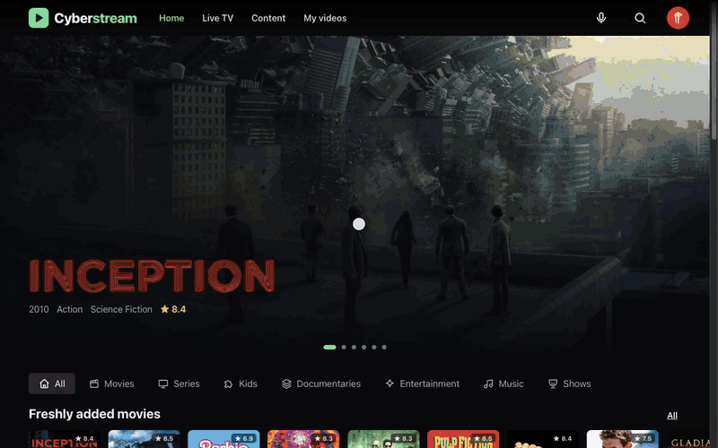
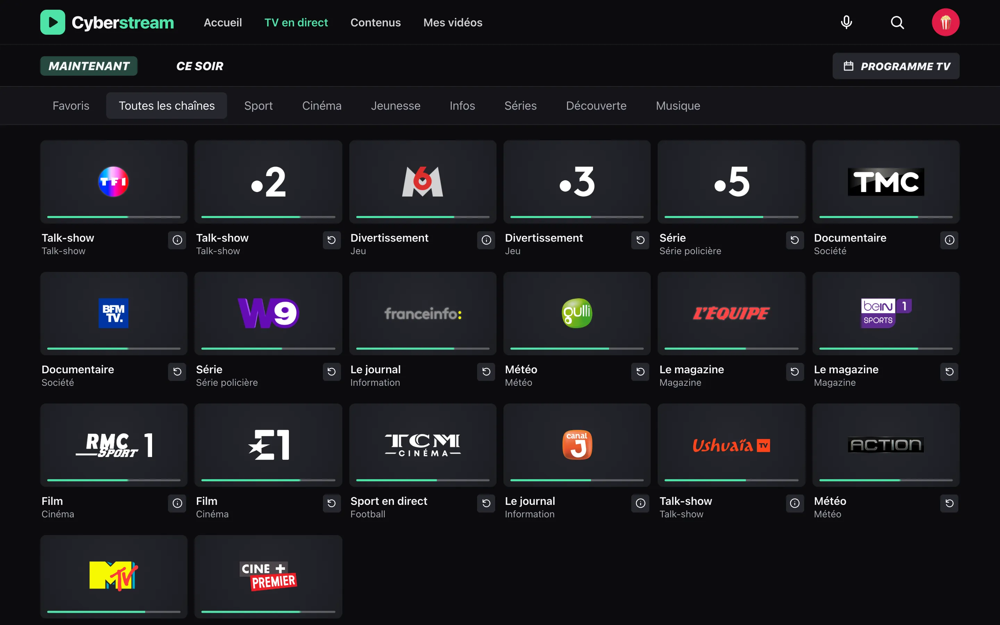
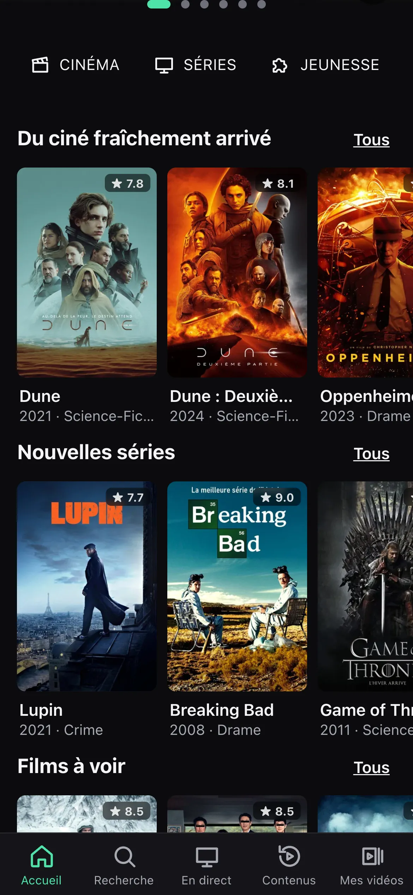

<p align="center">
  <a href="https://pickywawa.github.io/cyberstream/en/">
    
  </a>
</p>

<p align="center">
  <a href="https://github.com/pickywawa/cyberstream/releases/latest"></a>
  
  <a href="../../LICENSE"></a>
  
</p>

<p align="center">
  <b><a href="https://pickywawa.github.io/cyberstream/en/">ওয়েবসাইট</a></b> ·
  <b><a href="https://github.com/pickywawa/cyberstream/releases/latest">ডাউনলোড</a></b> ·
  <a href="#-%E0%A6%AC%E0%A7%88%E0%A6%B6%E0%A6%BF%E0%A6%B7%E0%A7%8D%E0%A6%9F%E0%A7%8D%E0%A6%AF">বৈশিষ্ট্য</a> ·
  <a href="#-%E0%A6%AD%E0%A6%BE%E0%A6%B7%E0%A6%BE-%E0%A6%93-%E0%A6%A6%E0%A7%87%E0%A6%B6">দেশ</a> ·
  <a href="#%EF%B8%8F-%E0%A6%B8%E0%A7%8D%E0%A6%95%E0%A7%8D%E0%A6%B0%E0%A6%BF%E0%A6%A8%E0%A6%B6%E0%A6%9F">স্ক্রিনশট</a> ·
  <a href="#%EF%B8%8F-%E0%A6%AC%E0%A6%BF%E0%A6%B2%E0%A7%8D%E0%A6%A1-%E0%A6%93-%E0%A6%9F%E0%A7%87%E0%A6%B8%E0%A7%8D%E0%A6%9F">বিল্ড</a>
  <br />
  <a href="../../README.md">English</a> · <a href="README.fr.md">Français</a> · <a href="README.es.md">Español</a> · <a href="README.de.md">Deutsch</a> · <a href="README.it.md">Italiano</a> · <a href="README.pt.md">Português</a> · <a href="README.ru.md">Русский</a> · <a href="README.zh.md">中文</a> · <a href="README.ja.md">日本語</a> · <a href="README.hi.md">हिन्दी</a> · <b>বাংলা</b> · <a href="README.ur.md">اردو</a> · <a href="README.ar.md">العربية</a> · <a href="README.id.md">Bahasa Indonesia</a>
</p>

---

**Cyberstream** আপনার **Xtream Codes** ও **M3U** উৎস চালায়: লাইভ চ্যানেল, টিভি গাইড, সিনেমা, সিরিজ ও ক্যাচ-আপ। এটি IPTV প্লেয়ার CyberTV-কে Rust-এ পোর্ট করে: একই WebAssembly মডিউল ব্রাউজারে, Android ফোন ও টিভিতে, iOS-এ এবং Electron-এ চলে। Android ভিডিও ডিকোডিং ও ট্র্যাক বাছাইয়ের জন্য Media3 ব্যবহার করে।

> [!NOTE]
> Cyberstream একটি প্লেয়ার। এটি কোনো কনটেন্ট দেয় না: আপনি নিজের উৎস ব্যবহার করেন।

<p align="center">
  
  <br />
  <sub>ডেমো উৎস ও TMDB মেটাডেটা দিয়ে রেকর্ড করা। ইন্টারফেস ইংরেজি ভাষায় দেখানো হয়েছে।</sub>
</p>

## ⚡ বৈশিষ্ট্য

| | |
| --- | --- |
| 📡 **Xtream ও M3U** | ক্যাটালগ খণ্ডে খণ্ডে পড়া হয়, ব্যাকআপ সার্ভার, ডিফারেনশিয়াল সিঙ্ক। |
| 🗓️ **XMLTV গাইড** | ভার্চুয়ালাইজড গ্রিড, “এখন” রেখা, আগের অনুষ্ঠানের ক্যাচ-আপ। |
| 🎬 **সিনেমা ও সিরিজ** | TMDB দিয়ে সমৃদ্ধ পাতা: অভিনেতা, কালেকশন, বয়স রেটিং, সিজন, যেখানে থেমেছিলেন সেখান থেকে, পরের পর্ব। |
| ⏸️ **লাইভ পজ** | ৩০ থেকে ৬০ মিনিটের লোকাল বাফার, ±১০ সেকেন্ড, লাইভে ফেরা, ব্যাকআপ স্ট্রিমে স্বয়ংক্রিয় বদল। |
| 🎙️ **ভয়েস কমান্ড** | “চ্যানেল ৫ চালাও”, “Dune খোঁজো”, “৩০ সেকেন্ড পিছাও”, ইন্টারফেসের ১৪টি ভাষায়। |
| 📱 **QR কোডে সেটআপ** | টিভি আপনার ফোন থেকে প্রোফাইল, উৎস ও সেটিংস নিয়ে নেয়। |
| 🔁 **বিনামূল্যে ক্যাচ-আপ** | ARTE, france.tv, Okoo, ARD Mediathek এবং সংবাদমাধ্যমের ৬০০-রও বেশি YouTube চ্যানেল, আপনার দেশ অনুযায়ী। |
| 💬 **সাবটাইটেল ও Trakt** | SRT, WebVTT, OpenSubtitles হ্যাশ মিলানো, Trakt স্ক্রবলিং ও ওয়াচলিস্ট। |
| 🌍 **১৪টি ভাষা, ৪২টি দেশ** | অনুসরণ করা প্রতিটি দেশের জন্য ফ্রি চ্যানেল, টিভি গাইড, রেডিও ও স্কোর, এক প্রোফাইলে একাধিক দেশ। |
| 👤 **প্রোফাইল** | প্রতি প্রোফাইলে আলাদা অবতার, ভাষা ও বয়সসীমা। সার্ভিসের টোকেন ডিভাইসের সুরক্ষিত ভাণ্ডারে থাকে। |

## 🌍 ভাষা ও দেশ

**ইন্টারফেস** ১৪টি ভাষায়: ফরাসি, ইংরেজি, জার্মান, স্প্যানিশ, ইতালীয়, পর্তুগিজ, আরবি, হিন্দি, চীনা, বাংলা, ইন্দোনেশীয়, উর্দু, রুশ ও জাপানি। আরবি ও উর্দু ডান থেকে বামে দেখানো হয়। ভয়েস কমান্ড, তারিখ, TMDB পাতার ভাষা ও স্পিচ রিকগনিশন প্রোফাইলের ভাষা অনুসরণ করে।

**এক প্রোফাইলে একাধিক দেশ।** প্রোফাইলে এক বা একাধিক দেশ বেছে নিন (যেমন বাংলাদেশ ও ভারত)। প্রথমটি প্রধান দেশ। অনুসরণ করা প্রতিটি দেশের জন্য অ্যাপ যোগ করে:

- **ফ্রি চ্যানেল**: [iptv-org](https://github.com/iptv-org/iptv)-এর তালিকাভুক্ত পাবলিক ফ্রি স্ট্রিম, একটি উৎস হিসেবে। প্রোফাইল তৈরির সময় “আমার দেশগুলোর ফ্রি চ্যানেল” বিকল্প দেওয়া হয়: IPTV সাবস্ক্রিপশন ছাড়াই অ্যাপ চলে।
- **ফ্রি টিভি গাইড**: ফ্রান্সের জন্য [xmltvfr.fr](https://xmltvfr.fr), অন্য দেশের জন্য [epgshare01](https://epgshare01.online)।
- **ক্যাচ-আপ**: france.tv ও Okoo (ফ্রান্স), ARD Mediathek (জার্মানি, অস্ট্রিয়া), ARTE (ইউরোপে, ছয়টি ভাষায়)।
- **YouTube**: বিষয়ভিত্তিক দেশের মিডিয়া চ্যানেল (খবর, খেলা, ডকুমেন্টারি, কমেডি, মিডিয়া, রেডিও)। সবগুলো যাচাই করা: প্রতিটি তার পাবলিক RSS ফিডের মাধ্যমে প্রকাশ করে।
- **রেডিও**: [Radio Browser](https://www.radio-browser.info) থেকে দেশের সবচেয়ে বেশি শোনা স্টেশন। সব দেশ অন্তর্ভুক্ত।
- **লাইভ স্কোর**: দেশের লিগগুলো।

**দেশ ফিল্টার।** “শুধু আমার দেশগুলোর চ্যানেল” বিকল্পটি উৎস ডাউনলোডের সময় অন্য দেশের চ্যানেল বিভাগ (“UK|”, “DE:”, “[BE]”…) বাদ দেয়। উৎস সেট করার সময়, প্রথম ডাউনলোডের আগে এটি দেওয়া হয়।

| দেশ | ফ্রি চ্যানেল | টিভি গাইড | ক্যাচ-আপ | YouTube | স্কোর |
| --- | --- | --- | --- | --- | --- |
| 🇫🇷 ফ্রান্স | ≈231 (TF1, France 2, M6, Arte) | হ্যাঁ | france.tv, Okoo, ARTE | 21 (BFMTV, franceinfo…) | Ligue 1, Champions League, Premier League |
| 🇧🇪 বেলজিয়াম | ≈60 (La Une, Tipik, RTL-TVI, BX1) | হ্যাঁ | ARTE | 10 (RTBF, RTBF Info…) | Pro League, Ligue 1, Champions League |
| 🇨🇭 সুইজারল্যান্ড | ≈137 (RTS, RSI, Couleur 3, 3sat) | হ্যাঁ | ARTE | 9 (RTS Info, Schweizer Radio und Fernsehen…) | Super League, Ligue 1, Bundesliga |
| 🇱🇺 লাক্সেমবার্গ | ≈20 (RTL, Eldo) | হ্যাঁ | ARTE | 2 (RTL Luxembourg, Wort…) | Ligue 1, Bundesliga, Champions League |
| 🇨🇦 কানাডা | ≈265 (CBC, CTV, Télé-Québec) | হ্যাঁ | — | 14 (CBC News, CTV News…) | NHL, NBA, NFL |
| 🇲🇦 মরক্কো | ≈13 (2M, Al Aoula, Medi1) | — | — | 10 (2MTV, Hespress…) | AFCON, Ligue 1, LaLiga |
| 🇩🇿 আলজেরিয়া | ≈9 (Canal Algérie, Ennahar) | — | — | 7 (Ennahar Tv Plus, EchoroukTV…) | AFCON, Ligue 1, Champions League |
| 🇹🇳 তিউনিসিয়া | ≈4 (Watania, Nessma) | — | — | 7 (Mosaique FM, Nessma TV…) | AFCON, Ligue 1, Champions League |
| 🇬🇧 যুক্তরাজ্য | ≈302 (BBC One, BBC News, Channel 4) | হ্যাঁ | ARTE | 30 (BBC News, Sky News…) | Premier League, Champions League |
| 🇮🇪 আয়ারল্যান্ড | ≈58 (RTÉ News, Virgin Media) | হ্যাঁ | ARTE | 9 (RTÉ News, The Irish Times…) | Premier Division, Premier League, Champions League |
| 🇺🇸 মার্কিন যুক্তরাষ্ট্র | ≈1538 (PBS, ABC News, CBS News) | হ্যাঁ | — | 41 (CNN, NBC News…) | NFL, NBA, NHL |
| 🇦🇺 অস্ট্রেলিয়া | ≈78 (ABC, 7, 9) | হ্যাঁ | — | 11 (9 News Australia, SBS News…) | AFL, A-League, Premier League |
| 🇳🇿 নিউজিল্যান্ড | ≈36 (TVNZ, Whakaata Māori) | হ্যাঁ | — | 6 (RNZ, 1News…) | A-League, Premier League |
| 🇩🇪 জার্মানি | ≈303 (Das Erste, ZDF, 3sat, tagesschau24) | হ্যাঁ | ARD Mediathek, ARTE | 28 (tagesschau, ZDFheute Nachrichten…) | Bundesliga, Champions League |
| 🇦🇹 অস্ট্রিয়া | ≈114 (ORF, ServusTV, PULS 24) | হ্যাঁ | ARD Mediathek, ARTE | 9 (PULS 24, Kronen Zeitung…) | Bundesliga (AT), Bundesliga, Champions League |
| 🇪🇸 স্পেন | ≈305 (3Cat, À Punt, 24 Horas, Atreseries) | হ্যাঁ | ARTE | 27 (Antena 3 Noticias, EL PAÍS…) | LaLiga, Champions League, NBA |
| 🇲🇽 মেক্সিকো | ≈179 (Canal 22, Canal Once, Azteca) | হ্যাঁ | — | 12 (NMás, MILENIO…) | Liga MX, Concacaf, LaLiga |
| 🇦🇷 আর্জেন্টিনা | ≈224 (Telefe, TN, A24) | হ্যাঁ | — | 11 (C5N, LA NACION…) | Liga Profesional, Libertadores, LaLiga |
| 🇨🇴 কলম্বিয়া | ≈171 (Canal Capital, Señal Colombia) | হ্যাঁ | — | 7 (Noticias Caracol, Noticias RCN…) | Primera A, Libertadores, LaLiga |
| 🇨🇱 চিলি | ≈220 (TVN, 24 Horas, T13) | হ্যাঁ | — | 9 (Teletrece, CHV Noticias…) | Primera División, Libertadores, LaLiga |
| 🇮🇹 ইতালি | ≈359 (Rai 1, Rai 2, Rai 3, Rai News 24) | হ্যাঁ | ARTE | 21 (RaiNews, Sky tg24…) | Serie A, Champions League |
| 🇵🇹 পর্তুগাল | ≈72 (RTP 1, RTP 2, RTP Notícias, SIC) | হ্যাঁ | — | 10 (RTP Notícias, TVI…) | Liga Portugal, Champions League |
| 🇧🇷 ব্রাজিল | ≈401 (TV Cultura, Record News, SBT) | হ্যাঁ | — | 23 (g1, CNN Brasil…) | Brasileirão, Libertadores, NBA |
| 🇳🇱 নেদারল্যান্ডস | ≈175 (NPO, AT5) | হ্যাঁ | — | 11 (NOS, RTL Nieuws…) | Eredivisie, Champions League |
| 🇹🇷 তুরস্ক | ≈180 (TRT 1, TRT Haber, NTV) | হ্যাঁ | — | 8 (TRT Haber, CNN TÜRK…) | Süper Lig, Champions League |
| 🇵🇱 পোল্যান্ড | ≈188 (TVP Info, TVP World) | হ্যাঁ | ARTE | 12 (tvn24, Polsat…) | Champions League |
| 🇷🇺 রাশিয়া | ≈518 (2x2, 360°, RT) | — | — | 19 (Телеканал Дождь, BBC News - Русская служба…) | RPL |
| 🇸🇦 সৌদি আরব | ≈56 (Al Saudiya, Al Ekhbariya, Asharq News) | হ্যাঁ | — | 17 (AlArabiya العربية, سكاي نيوز عربية…) | Saudi Pro League, AFC Champions League, Premier League |
| 🇦🇪 সংযুক্ত আরব আমিরাত | ≈23 (Dubai TV, Abu Dhabi TV) | হ্যাঁ | — | 10 (سكاي نيوز عربية, AlArabiya العربية…) | AFC Champions League, Premier League, LaLiga |
| 🇶🇦 কাতার | ≈10 (Al Jazeera, Al Rayyan) | — | — | 4 (Al Jazeera English, العربي - أخبار…) | AFC Champions League, Premier League, LaLiga |
| 🇪🇬 মিশর | ≈21 (Nile Drama, MBC Masr, Al Ghad) | — | — | 11 (CBC Egypt, Sada Elbalad - صدى البلد…) | AFCON, Premier League, LaLiga |
| 🇮🇳 ভারত | ≈826 (DD National, DD News, Aaj Tak, NDTV) | হ্যাঁ | — | 30 (Aaj Tak, NDTV…) | ISL, Premier League |
| 🇵🇰 পাকিস্তান | ≈105 (PTV, ARY News, Dunya News) | — | — | 19 (Geo News, ARY News…) | Premier League |
| 🇧🇩 বাংলাদেশ | ≈37 (ATN Bangla, NTV, T Sports, Ekhon) | — | — | 17 (SOMOY TV, Jamuna TV Plus…) | Premier League |
| 🇮🇩 ইন্দোনেশিয়া | ≈177 (TVRI, Kompas TV, Metro TV) | হ্যাঁ | — | 28 (CNN Indonesia, tvOneNews…) | Super League, Premier League |
| 🇲🇾 মালয়েশিয়া | ≈6 (TV1, TV2) | হ্যাঁ | — | 6 (Astro AWANI, Berita Harian Online…) | Super League, Premier League |
| 🇸🇬 সিঙ্গাপুর | ≈9 (CNA) | হ্যাঁ | — | 5 (CNA Insider, CNA…) | Premier League |
| 🇨🇳 চীন | ≈156 (CCTV-1, CCTV-4, CCTV-13) | — | — | 11 (CGTN, CCTV Video News Agency…) | CSL, NBA |
| 🇹🇼 তাইওয়ান | ≈34 (PTS, TTV) | — | — | 10 (TVBS NEWS, SETN News Network…) | NBA, MLB |
| 🇭🇰 হংকং | ≈18 (RTHK, TVB) | হ্যাঁ | — | 7 (TVB NEWS Official 無綫新聞, RTHK 香港電台…) | Premier League, NBA |
| 🇯🇵 জাপান | ≈17 (NHK General, Nippon TV, TV Asahi, Fuji TV) | হ্যাঁ | — | 22 (ANNnewsCH, TBS NEWS DIG Powered by JNN…) | J1 League, MLB |
| 🇰🇷 দক্ষিণ কোরিয়া | ≈72 (KBS, MBC, Arirang) | — | — | 16 (YTN, SBS News…) | MLB, Premier League |

ফ্রি চ্যানেলের সংখ্যা লেখার সময়কার iptv-org তালিকা থেকে নেওয়া। এর কিছু স্ট্রিম শুধু নিজের দেশে চলে বা প্রায়ই বদলায়। ARD-এর কিছু ভিডিও শুধু জার্মানি, অস্ট্রিয়া ও সুইজারল্যান্ডে দেখা যায়।

**যেসব সার্ভিস অন্তর্ভুক্ত নয়।** BBC iPlayer, ITVX ও Channel 4-এর জন্য অ্যাকাউন্ট ও যুক্তরাজ্য থেকে সংযোগ লাগে, iPlayer-এর জন্য টিভি লাইসেন্সও। PBS প্রতিটি স্টেশনের অ্যাপ ও অ্যাকাউন্টের মাধ্যমে চলে। RTVE Play তার ভিডিও DRM দিয়ে সুরক্ষিত রাখে। RaiPlay তার ক্যাটালগের বড় অংশ ইতালিতে সীমিত রাখে, প্রায়ই সাইন-ইন সহ। এদের লাইভ চ্যানেল ফ্রি-টু-এয়ার সম্প্রচারিত হলে ফ্রি চ্যানেলে দেখা যায়, আর এদের YouTube চ্যানেল ক্যাচ-আপে আছে।

## 🖼️ স্ক্রিনশট

<table>
  <tr>
    <td width="50%"><p align="center"><sub>হোম</sub></p></td>
    <td width="50%"><p align="center"><sub>লাইভ টিভি</sub></p></td>
  </tr>
  <tr>
    <td><p align="center"><sub>টিভি গাইড</sub></p></td>
    <td><p align="center"><sub>সিনেমার পাতা</sub></p></td>
  </tr>
  <tr>
    <td><p align="center"><sub>সিরিজ</sub></p></td>
    <td><p align="center"><sub>প্লেয়ার — টেস্ট স্ট্রিম <i>Big Buck Bunny</i> © Blender Foundation, CC BY</sub></p></td>
  </tr>
</table>

<p align="center">
  
  &nbsp;
  
  &nbsp;
  
</p>

## 📦 ইনস্টল

[সর্বশেষ রিলিজ](https://github.com/pickywawa/cyberstream/releases/latest) থেকে `Cyberstream-x.y.z.apk` ডাউনলোড করুন, তারপর আপনার ফোন বা টিভিতে ইনস্টল করুন:

```sh
adb -d install -r Cyberstream-1.0.1.apk
```

Android প্যাকেজ হলো `app.cyberstream.player`। একই APK ফোনে ইনস্টল হয় এবং Android TV লঞ্চারেও দেখা যায়। ঘোষিত ন্যূনতম সংস্করণ Android 7 (API 24)। ইন্টারফেসের জন্য WebAssembly ও JavaScript মডিউল সমর্থনকারী WebView লাগে; শুধু সিস্টেম সংস্করণ এর নিশ্চয়তা দেয় না।

## 🦀 পোর্টিংয়ের অবস্থা

প্রি-রিলিজটি CyberTV 0.16.0 অনুসরণ করে। পোর্ট এখনও হাইব্রিড।

| বৈশিষ্ট্য | এই সংস্করণে বাস্তবায়ন |
| --- | --- |
| Xtream ও M3U উৎস | Rust ক্যাটালগ খণ্ডে খণ্ডে পড়ে, এন্ট্রি সাজায় এবং প্লেব্যাক ও ক্যাচ-আপ URL তৈরি করে। TypeScript ওয়ার্কার অনুরোধ, ব্যাকআপ সার্ভার, ব্যাকগ্রাউন্ড ডাউনলোড ও IndexedDB লেনদেন সমন্বয় করে। |
| XMLTV গাইড | Rust gzip খোলে, অনুষ্ঠান পড়ে, টাইম জোন সামলায় এবং গ্রিডের দৃশ্যমান ঘর আঁকে। ইমপোর্টের সময় IndexedDB আগের সূচি পাওয়া যায় এমন রাখে। |
| সার্চ ও র‍্যাঙ্কিং | Rust শিরোনামের ইনডেক্স বানায়, চ্যানেল র‍্যাঙ্ক করে, ভাষা শনাক্ত করে এবং LZ4-সংকুচিত পাতা থেকে ক্যাটালগ ইনডেক্স পুনরুদ্ধার করে। |
| সিনেমা ও সিরিজ | Rust Xtream পর্ব ও TMDB মেটাডেটা পড়ে, বয়স রেটিং, অভিনেতা ও কালেকশনসহ। Rust পাতার হেডার, সিজন, পর্ব, লাইব্রেরি ও কার্ড আঁকে। ট্র্যাক বাছাই ও স্ট্রিমের ভেতরে সিকের সিদ্ধান্তও Rust নেয়। |
| ক্যাচ-আপ ও সাবটাইটেল | Rust ARTE ও france.tv-এর ক্যাটালগ ও স্ট্রিম, YouTube RSS ফিড, SRT ও WebVTT এবং OpenSubtitles হ্যাশ সামলায়। |
| ইন্টারফেস ও রিমোট | প্রধান মেনু, প্রোফাইল টাইল, অনুবাদ, দিকনির্দেশক নেভিগেশন, ভার্চুয়ালাইজেশন ও ভয়েস কমান্ড Rust-এ। Trakt ক্লায়েন্ট, OpenSubtitles র‍্যাঙ্কিং ও QR কোড বিনিময়ের যাচাইও। হোম, গ্রিড, সার্চ ফলাফল ও Replay পাতার Rust ভিউ আছে। React ও TypeScript স্ক্রিন মাউন্ট করে, ইভেন্ট ও কয়েকটি সার্ভিস ইন্টিগ্রেশন সামলায়। |
| ডিভাইসের বৈশিষ্ট্য | Android, Media3, ক্যাশ, টাইমশিফট, সুরক্ষিত ভাণ্ডার ও টিভি পেয়ারিংয়ের জন্য Java ব্রিজ রাখে। iOS হোস্ট Swift এবং ডেস্কটপ হোস্ট Electron ব্যবহার করে। |

মাইগ্রেশনের সময় ব্যবহারের প্রবাহ ধরে রাখতে CyberTV-এর স্ক্রিনগুলো নেওয়া হয়েছে। Android TV, iOS ও ডেস্কটপে পূর্ণ সমতা এখনও পরীক্ষা করা বাকি। মূল স্পেসিফিকেশন [docs/SPECIFICATIONS.md](../SPECIFICATIONS.md)-এ (ফরাসি ভাষায়) আছে।

## 🛠️ বিল্ড ও টেস্ট

ওয়েব ও লোকাল টেস্টের প্রয়োজনীয়তা: WebAssembly টার্গেটসহ স্টেবল Rust, Node.js 22.12 বা পরবর্তী, এবং npm। বাইন্ডিং জেনারেটরের সংস্করণ crate-এর সংস্করণের সঙ্গে মিলতে হবে।

```sh
rustup target add wasm32-unknown-unknown
cargo install --locked wasm-bindgen-cli --version 0.2.108
npm ci
cargo test --locked
npm test
npm run build
```

Android SDK 36, JDK 21 এবং সেট করা `JAVA_HOME` ও `ANDROID_HOME` সহ:

```sh
npm run android:apk
adb -d install -r android/app/build/outputs/apk/debug/app-debug.apk
```

প্রোফাইল ও উৎস ডিভাইসে সেট করা হয়। নকল ডেটা দিয়ে ওয়েব সংস্করণ চালাতে `npm run dev -- --host 127.0.0.1` চালান এবং সেটআপের সময় ডেমো উৎস বেছে নিন। ঐচ্ছিক সার্ভিস কী প্রোফাইল সেটিংসে দিতে হয়। সংস্করণ 0.16.3 থেকে প্লেয়ার Cyberstream-এর GitHub রিলিজ (প্রি-রিলিজসহ) পরীক্ষা করে। প্রতিটি Android রিলিজে তার `update.json` ম্যানিফেস্ট ও তাতে উল্লিখিত APK সংযুক্ত থাকতে হবে। অন্য চ্যানেল পরীক্ষা করতে বিল্ডের সময় `CYBER_UPDATE_URL`-এ একটি ম্যানিফেস্ট URL দিন। 0.16.1 ও 0.16.2 সংস্করণের ব্যবহারকারীদের একবার হাতে নতুন APK ইনস্টল করতে হবে।

## 📺 Android TV-তে রিসোর্স

ক্যাটালগ গ্রিড সাজানো ID রাখে এবং দৃশ্যমান সারি অনুযায়ী সারি ধরে পোস্টার লোড করে। প্রথম ডাউনলোড প্রোফাইলের অডিও ভাষার বিভাগগুলো বেছে নেয়, সব ভাষা রাখার বিকল্পসহ।

Xtream এন্ট্রির একটি ফিঙ্গারপ্রিন্ট দুই সিঙ্কের মধ্যে অপরিবর্তিত সারি ধরে রাখে। গাইডও স্থির স্লট ID রাখে এবং বদলানো অনুষ্ঠান নতুন করে লেখে।

লঞ্চার ও ইন্টারফেসের আইকন ভেক্টর ছবি। Android প্রাপ্ত SVG ও অ্যানিমেশন রাখে এবং ছবিকে ব্যবহার অনুযায়ী রিসাইজ করে। সর্বোচ্চ প্রান্ত লোগোর জন্য ২২৪ পিক্সেল, কার্ডের জন্য ৪৪৮ এবং হিরো ছবির জন্য ১,০২৪। একসঙ্গে দুটি ছবি ডিকোড চলতে পারে। ডিস্ক ক্যাশের লক্ষ্য ৯৬ MiB, আর সবচেয়ে কম সাম্প্রতিক ব্যবহৃত ফাইল নিয়মিত সরানো হয়।

Android-এ পারফরম্যান্স মোড ডিফল্টভাবে চালু। হোম সিনেমার একটি সীমিত নমুনা পড়ে। এই মোডে সার্চ প্রয়োজনমতো ইনডেক্স তৈরি করে। কম মেমরি হিসেবে চিহ্নিত ডিভাইসে প্লেয়ার ২৪ MiB মিডিয়া বাফারের লক্ষ্য রাখে। এই সীমাগুলো নির্দিষ্ট উপ-ব্যবস্থার জন্য। মোট মেমরি, চালু হওয়ার সময় ও মসৃণতা লক্ষ্য টিভিতে মাপতে হবে।

## 🌐 ওয়েবসাইট

ওয়েবসাইট [`docs/`](../)-এ আছে (সাধারণ HTML, CSS ও JS, কোনো বিল্ড ধাপ নেই), রুটে ফরাসি এবং `docs/en/`-এ ইংরেজি। এটি GitHub Pages দিয়ে `main` ব্রাঞ্চের `/docs` ফোল্ডার থেকে প্রকাশিত হয়। লোকাল প্রিভিউ:

```sh
python3 -m http.server 8090 -d docs
```

## 📄 লাইসেন্স

কোড [MIT](../../LICENSE) লাইসেন্সের অধীনে প্রকাশিত।

---

<p align="center"><sub>পোস্টার, ছবি ও মেটাডেটা: <a href="https://www.themoviedb.org/">TMDB</a>। এই পণ্য TMDB API ব্যবহার করে, তবে TMDB দ্বারা অনুমোদিত বা প্রত্যয়িত নয়। চ্যানেল লোগো ও ফ্রি চ্যানেলের তালিকা: <a href="https://github.com/iptv-org">iptv-org</a>; ট্রেডমার্ক ও ছবি তাদের মালিকদের। টিভি গাইড: xmltvfr.fr ও epgshare01। রেডিও: Radio Browser। প্লেয়ারের ভিডিও: টেস্ট স্ট্রিম <i>Big Buck Bunny</i> © Blender Foundation, CC BY 3.0।</sub></p>
