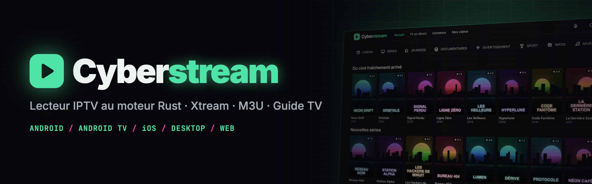

<p align="center">
  <a href="https://pickywawa.github.io/cyberstream/">
    
  </a>
</p>

<p align="center">
  <a href="https://github.com/pickywawa/cyberstream/releases/latest"></a>
  
  <a href="../../LICENSE"></a>
  
</p>

<p align="center">
  <b><a href="https://pickywawa.github.io/cyberstream/">Site</a></b> ·
  <b><a href="https://github.com/pickywawa/cyberstream/releases/latest">Télécharger</a></b> ·
  <a href="#-fonctions">Fonctions</a> ·
  <a href="#-langues-et-pays">Pays</a> ·
  <a href="#-captures">Captures</a> ·
  <a href="#-compiler-et-tester">Compiler</a>
  <br />
  <a href="../../README.md">English</a> · <b>Français</b> · <a href="README.es.md">Español</a> · <a href="README.de.md">Deutsch</a> · <a href="README.it.md">Italiano</a> · <a href="README.pt.md">Português</a> · <a href="README.ru.md">Русский</a> · <a href="README.zh.md">中文</a> · <a href="README.ja.md">日本語</a> · <a href="README.hi.md">हिन्दी</a> · <a href="README.bn.md">বাংলা</a> · <a href="README.ur.md">اردو</a> · <a href="README.ar.md">العربية</a> · <a href="README.id.md">Bahasa Indonesia</a>
</p>

---

**Cyberstream** lit tes sources **Xtream Codes** et **M3U** : chaînes en direct, guide TV, films, séries et replay. Il porte le lecteur IPTV CyberTV vers Rust : le même module WebAssembly sert le navigateur, Android mobile et TV, iOS et Electron. Android utilise Media3 pour le décodage vidéo et le choix des pistes.

> [!NOTE]
> Cyberstream est un lecteur. Il ne fournit aucun contenu : tu utilises tes propres sources.

<p align="center">
  
  <br />
  <sub>Enregistré avec la source de démonstration et les métadonnées TMDB.</sub>
</p>

## ⚡ Fonctions

| | |
| --- | --- |
| 📡 **Xtream & M3U** | Catalogues lus par blocs, serveurs de secours, synchronisation différentielle. |
| 🗓️ **Guide TV XMLTV** | Grille virtualisée, ligne « maintenant », rattrapage des programmes passés. |
| 🎬 **Films & séries** | Fiches enrichies par TMDB : casting, collections, âge, saisons, reprise, épisode suivant. |
| ⏸️ **Pause du direct** | Tampon local de 30 à 60 min, ±10 s, retour au direct, bascule vers un flux de secours. |
| 🎙️ **Commande vocale** | « Mets la chaîne 5 », « recherche Dune », « recule de 30 secondes », dans les 14 langues de l’interface. |
| 📱 **Installation par QR code** | La TV récupère profil, sources et réglages depuis le téléphone. |
| 🔁 **Replay gratuit** | ARTE, france.tv, Okoo, ARD Mediathek et plus de 600 chaînes YouTube de médias, selon tes pays. |
| 💬 **Sous-titres & Trakt** | SRT, WebVTT, OpenSubtitles par empreinte, scrobble et watchlist Trakt. |
| 🌍 **14 langues, 42 pays** | Chaînes gratuites, guide TV, radios et scores de chaque pays suivi, plusieurs pays par profil. |
| 👤 **Profils** | Avatar, langue et limite d’âge par profil. Jetons rangés dans le coffre de secrets de l’appareil. |

## 🌍 Langues et pays

**Interface** en 14 langues : français, anglais, allemand, espagnol, italien, portugais, arabe, hindi, chinois, bengali, indonésien, ourdou, russe et japonais. L’arabe et l’ourdou s’affichent de droite à gauche. Les commandes vocales, les dates, la langue des fiches TMDB et la reconnaissance vocale suivent la langue du profil.

**Plusieurs pays par profil.** Dans le profil, choisis un ou plusieurs pays (par exemple France et Suisse). Le premier est le pays principal. Pour chaque pays suivi, l’app ajoute :

- **Chaînes gratuites** : les flux publics et gratuits listés par [iptv-org](https://github.com/iptv-org/iptv), ajoutés comme une source. Option « Chaînes gratuites de mes pays », proposée dès la création du profil : l’app peut servir sans abonnement IPTV.
- **Guide TV gratuit** : [xmltvfr.fr](https://xmltvfr.fr) pour la France, [epgshare01](https://epgshare01.online) pour les autres pays.
- **Replay** : france.tv et Okoo (France), ARD Mediathek (Allemagne, Autriche), ARTE (en six langues, en Europe).
- **YouTube** : chaînes de médias du pays par thème (info, sport, docs, humour, médias, radio). Toutes ont été vérifiées : chacune publie via son flux RSS public.
- **Radios** : les stations les plus écoutées du pays, via [Radio Browser](https://www.radio-browser.info). Tous les pays sont couverts.
- **Scores en direct** : championnats du pays.

**Filtre par pays.** L’option « Seulement les chaînes de mes pays » laisse de côté, au téléchargement de ta source, les catégories de chaînes des autres pays (« UK| », « DE: », « [BE] »…). Elle est proposée dès la configuration de la source, avant le premier téléchargement.

| Pays | Chaînes gratuites | Guide TV | Replay | YouTube | Scores |
| --- | --- | --- | --- | --- | --- |
| 🇫🇷 France | ≈231 (TF1, France 2, M6, Arte) | oui | france.tv, Okoo, ARTE | 21 (BFMTV, franceinfo…) | Ligue 1, Ligue des champions, Premier League |
| 🇧🇪 Belgique | ≈60 (La Une, Tipik, RTL-TVI, BX1) | oui | ARTE | 10 (RTBF, RTBF Info…) | Pro League, Ligue 1, Ligue des champions |
| 🇨🇭 Suisse | ≈137 (RTS, RSI, Couleur 3, 3sat) | oui | ARTE | 9 (RTS Info, Schweizer Radio und Fernsehen…) | Super League, Ligue 1, Bundesliga |
| 🇱🇺 Luxembourg | ≈20 (RTL, Eldo) | oui | ARTE | 2 (RTL Luxembourg, Wort…) | Ligue 1, Bundesliga, Ligue des champions |
| 🇨🇦 Canada | ≈265 (CBC, CTV, Télé-Québec) | oui | — | 14 (CBC News, CTV News…) | NHL, NBA, NFL |
| 🇲🇦 Maroc | ≈13 (2M, Al Aoula, Medi1) | — | — | 10 (2MTV, Hespress…) | CAN, Ligue 1, LaLiga |
| 🇩🇿 Algérie | ≈9 (Canal Algérie, Ennahar) | — | — | 7 (Ennahar Tv Plus, EchoroukTV…) | CAN, Ligue 1, Ligue des champions |
| 🇹🇳 Tunisie | ≈4 (Watania, Nessma) | — | — | 7 (Mosaique FM, Nessma TV…) | CAN, Ligue 1, Ligue des champions |
| 🇬🇧 Royaume-Uni | ≈302 (BBC One, BBC News, Channel 4) | oui | ARTE | 30 (BBC News, Sky News…) | Premier League, Ligue des champions |
| 🇮🇪 Irlande | ≈58 (RTÉ News, Virgin Media) | oui | ARTE | 9 (RTÉ News, The Irish Times…) | Premier Division, Premier League, Ligue des champions |
| 🇺🇸 États-Unis | ≈1538 (PBS, ABC News, CBS News) | oui | — | 41 (CNN, NBC News…) | NFL, NBA, NHL |
| 🇦🇺 Australie | ≈78 (ABC, 7, 9) | oui | — | 11 (9 News Australia, SBS News…) | AFL, A-League, Premier League |
| 🇳🇿 Nouvelle-Zélande | ≈36 (TVNZ, Whakaata Māori) | oui | — | 6 (RNZ, 1News…) | A-League, Premier League |
| 🇩🇪 Allemagne | ≈303 (Das Erste, ZDF, 3sat, tagesschau24) | oui | ARD Mediathek, ARTE | 28 (tagesschau, ZDFheute Nachrichten…) | Bundesliga, Ligue des champions |
| 🇦🇹 Autriche | ≈114 (ORF, ServusTV, PULS 24) | oui | ARD Mediathek, ARTE | 9 (PULS 24, Kronen Zeitung…) | Bundesliga (AT), Bundesliga, Ligue des champions |
| 🇪🇸 Espagne | ≈305 (3Cat, À Punt, 24 Horas, Atreseries) | oui | ARTE | 27 (Antena 3 Noticias, EL PAÍS…) | LaLiga, Ligue des champions, NBA |
| 🇲🇽 Mexique | ≈179 (Canal 22, Canal Once, Azteca) | oui | — | 12 (NMás, MILENIO…) | Liga MX, Concacaf, LaLiga |
| 🇦🇷 Argentine | ≈224 (Telefe, TN, A24) | oui | — | 11 (C5N, LA NACION…) | Liga Profesional, Libertadores, LaLiga |
| 🇨🇴 Colombie | ≈171 (Canal Capital, Señal Colombia) | oui | — | 7 (Noticias Caracol, Noticias RCN…) | Primera A, Libertadores, LaLiga |
| 🇨🇱 Chili | ≈220 (TVN, 24 Horas, T13) | oui | — | 9 (Teletrece, CHV Noticias…) | Primera División, Libertadores, LaLiga |
| 🇮🇹 Italie | ≈359 (Rai 1, Rai 2, Rai 3, Rai News 24) | oui | ARTE | 21 (RaiNews, Sky tg24…) | Serie A, Ligue des champions |
| 🇵🇹 Portugal | ≈72 (RTP 1, RTP 2, RTP Notícias, SIC) | oui | — | 10 (RTP Notícias, TVI…) | Liga Portugal, Ligue des champions |
| 🇧🇷 Brésil | ≈401 (TV Cultura, Record News, SBT) | oui | — | 23 (g1, CNN Brasil…) | Brasileirão, Libertadores, NBA |
| 🇳🇱 Pays-Bas | ≈175 (NPO, AT5) | oui | — | 11 (NOS, RTL Nieuws…) | Eredivisie, Ligue des champions |
| 🇹🇷 Turquie | ≈180 (TRT 1, TRT Haber, NTV) | oui | — | 8 (TRT Haber, CNN TÜRK…) | Süper Lig, Ligue des champions |
| 🇵🇱 Pologne | ≈188 (TVP Info, TVP World) | oui | ARTE | 12 (tvn24, Polsat…) | Ligue des champions |
| 🇷🇺 Russie | ≈518 (2x2, 360°, RT) | — | — | 19 (Телеканал Дождь, BBC News - Русская служба…) | RPL |
| 🇸🇦 Arabie saoudite | ≈56 (Al Saudiya, Al Ekhbariya, Asharq News) | oui | — | 17 (AlArabiya العربية, سكاي نيوز عربية…) | Saudi Pro League, AFC Champions League, Premier League |
| 🇦🇪 Émirats arabes unis | ≈23 (Dubai TV, Abu Dhabi TV) | oui | — | 10 (سكاي نيوز عربية, AlArabiya العربية…) | AFC Champions League, Premier League, LaLiga |
| 🇶🇦 Qatar | ≈10 (Al Jazeera, Al Rayyan) | — | — | 4 (Al Jazeera English, العربي - أخبار…) | AFC Champions League, Premier League, LaLiga |
| 🇪🇬 Égypte | ≈21 (Nile Drama, MBC Masr, Al Ghad) | — | — | 11 (CBC Egypt, Sada Elbalad - صدى البلد…) | CAN, Premier League, LaLiga |
| 🇮🇳 Inde | ≈826 (DD National, DD News, Aaj Tak, NDTV) | oui | — | 30 (Aaj Tak, NDTV…) | ISL, Premier League |
| 🇵🇰 Pakistan | ≈105 (PTV, ARY News, Dunya News) | — | — | 19 (Geo News, ARY News…) | Premier League |
| 🇧🇩 Bangladesh | ≈37 (ATN Bangla, NTV, T Sports, Ekhon) | — | — | 17 (SOMOY TV, Jamuna TV Plus…) | Premier League |
| 🇮🇩 Indonésie | ≈177 (TVRI, Kompas TV, Metro TV) | oui | — | 28 (CNN Indonesia, tvOneNews…) | Super League, Premier League |
| 🇲🇾 Malaisie | ≈6 (TV1, TV2) | oui | — | 6 (Astro AWANI, Berita Harian Online…) | Super League, Premier League |
| 🇸🇬 Singapour | ≈9 (CNA) | oui | — | 5 (CNA Insider, CNA…) | Premier League |
| 🇨🇳 Chine | ≈156 (CCTV-1, CCTV-4, CCTV-13) | — | — | 11 (CGTN, CCTV Video News Agency…) | CSL, NBA |
| 🇹🇼 Taïwan | ≈34 (PTS, TTV) | — | — | 10 (TVBS NEWS, SETN News Network…) | NBA, MLB |
| 🇭🇰 Hong Kong | ≈18 (RTHK, TVB) | oui | — | 7 (TVB NEWS Official 無綫新聞, RTHK 香港電台…) | Premier League, NBA |
| 🇯🇵 Japon | ≈17 (NHK General, Nippon TV, TV Asahi, Fuji TV) | oui | — | 22 (ANNnewsCH, TBS NEWS DIG Powered by JNN…) | J1 League, MLB |
| 🇰🇷 Corée du Sud | ≈72 (KBS, MBC, Arirang) | — | — | 16 (YTN, SBS News…) | MLB, Premier League |

Le nombre de chaînes gratuites vient des listes iptv-org au moment de l’écriture. Une partie de ces flux est réservée à leur pays ou change souvent. Certaines vidéos ARD ne sont visibles qu’en Allemagne, Autriche et Suisse.

**Services non intégrés.** BBC iPlayer, ITVX et Channel 4 demandent un compte et une connexion depuis le Royaume-Uni, ainsi qu’une redevance pour iPlayer. PBS passe par l’app et le compte de chaque station. RTVE Play protège ses vidéos par DRM. RaiPlay réserve une grande partie de son catalogue à l’Italie, souvent avec connexion. Leurs chaînes en direct apparaissent dans les chaînes gratuites quand elles sont diffusées en clair, et leurs chaînes YouTube sont dans le replay.

## 🖼️ Captures

<table>
  <tr>
    <td width="50%"><p align="center"><sub>Accueil</sub></p></td>
    <td width="50%"><p align="center"><sub>TV en direct</sub></p></td>
  </tr>
  <tr>
    <td><p align="center"><sub>Programme TV</sub></p></td>
    <td><p align="center"><sub>Fiche film</sub></p></td>
  </tr>
  <tr>
    <td><p align="center"><sub>Série</sub></p></td>
    <td><p align="center"><sub>Lecteur — flux de test <i>Big Buck Bunny</i> © Blender Foundation, CC BY</sub></p></td>
  </tr>
</table>

<p align="center">
  
  &nbsp;
  
  &nbsp;
  
</p>

## 📦 Installer

Télécharge `Cyberstream-x.y.z.apk` depuis la [dernière publication](https://github.com/pickywawa/cyberstream/releases/latest), puis installe-le sur le téléphone ou sur la TV :

```sh
adb -d install -r Cyberstream-1.0.1.apk
```

Le paquet Android est `app.cyberstream.player`. Le même APK s’installe sur mobile et apparaît dans le lanceur Android TV. Le minimum déclaré est Android 7 (API 24). L’interface nécessite un WebView compatible WebAssembly et modules JavaScript. La version du système seule ne garantit pas cette compatibilité.

## 🦀 État du portage

La préversion suit CyberTV 0.16.0. Le portage reste hybride.

| Fonction | Implémentation dans cette version |
| --- | --- |
| Sources Xtream et M3U | Rust lit les catalogues par blocs, classe les entrées et construit les adresses de lecture et de rattrapage. Le worker TypeScript orchestre les requêtes, les serveurs de secours, les téléchargements en arrière-plan et les transactions IndexedDB. |
| Guide XMLTV | Rust décompresse gzip, lit les programmes, gère les fuseaux et rend les cellules visibles de la grille. IndexedDB garde l’ancien horaire disponible pendant un import. |
| Recherche et classement | Rust indexe les titres, classe les chaînes, reconnaît les langues et restaure l’index du catalogue depuis des pages compressées LZ4. |
| Films et séries | Rust lit les épisodes Xtream et les métadonnées TMDB, dont les restrictions d’âge, acteurs et collections. Rust rend les en-têtes des fiches, les saisons, les épisodes, la bibliothèque et les cartes. La sélection des pistes et les décisions de recherche dans le flux utilisent aussi Rust. |
| Replay et sous-titres | Rust traite les catalogues et flux ARTE et france.tv, les flux RSS YouTube, les formats SRT et WebVTT et l’empreinte OpenSubtitles. |
| Interface et télécommande | Les menus principaux, les tuiles de profil, les traductions, le déplacement directionnel, la virtualisation et les commandes vocales utilisent Rust. Le client Trakt, le classement OpenSubtitles et la validation des échanges par QR code utilisent également Rust. L’accueil, les grilles, les résultats de recherche et les fiches Replay ont des vues Rust. React et TypeScript assurent le montage des écrans, les événements et plusieurs intégrations de services. |
| Fonctions d’appareil | Android conserve les ponts Java pour Media3, le cache, le timeshift, le coffre de secrets et l’appairage TV. L’hôte iOS utilise Swift et l’hôte de bureau utilise Electron. |

Les écrans de CyberTV ont été repris pour conserver les parcours pendant la migration. La parité complète sur Android TV, iOS et ordinateur reste à tester. Les spécifications d’origine se trouvent dans [docs/SPECIFICATIONS.md](../SPECIFICATIONS.md).

## 🛠️ Compiler et tester

Prérequis pour le web et les tests locaux : Rust stable avec la cible WebAssembly, Node.js 22.12 ou ultérieur et npm. Le générateur de liaisons doit correspondre à la version du crate.

```sh
rustup target add wasm32-unknown-unknown
cargo install --locked wasm-bindgen-cli --version 0.2.108
npm ci
cargo test --locked
npm test
npm run build
```

Avec le SDK Android 36, JDK 21, `JAVA_HOME` et `ANDROID_HOME` configurés :

```sh
npm run android:apk
adb -d install -r android/app/build/outputs/apk/debug/app-debug.apk
```

Le profil et les sources se configurent sur l’appareil. Pour tester le web avec les données fictives, lancer `npm run dev -- --host 127.0.0.1` et sélectionner la source de démonstration pendant la configuration. Les clés de services facultatifs se renseignent dans les paramètres du profil. Depuis la version 0.16.3, le lecteur vérifie les publications GitHub de Cyberstream, préversions comprises. Chaque publication Android doit joindre son manifeste `update.json` et l’APK qu’il référence. Pour tester un autre canal, définir `CYBER_UPDATE_URL` avec l’URL d’un manifeste lors du build. Les utilisateurs des versions 0.16.1 et 0.16.2 doivent installer manuellement une première fois un APK plus récent.

## 📺 Ressources sur Android TV

La grille du catalogue conserve des identifiants triés et lit les affiches par rangée visible. Le premier téléchargement sélectionne les catégories dans les langues audio du profil, avec une option pour garder toutes les langues.

Une empreinte des entrées Xtream permet de conserver les lignes inchangées entre deux synchronisations. Le guide conserve aussi les identifiants des créneaux stables et réécrit les programmes modifiés.

Les lanceurs et les icônes d’interface utilisent des dessins vectoriels. Android conserve les SVG et animations reçus et adapte les photographies à leur usage. Le bord maximal est de 224 pixels pour un logo, 448 pour une carte et 1 024 pour un visuel principal. Deux décodages d’image peuvent fonctionner simultanément. Le cache disque vise 96 Mio avec éviction périodique des fichiers les moins récemment utilisés.

Le mode performance est activé par défaut sur Android. L’accueil lit un échantillon borné de films. La recherche construit son index à la demande dans ce mode. Sur un appareil identifié comme pauvre en mémoire, le lecteur cible 24 Mio de tampon média. Ces limites encadrent des sous-systèmes précis. La mémoire totale, le temps de démarrage et la fluidité doivent être mesurés sur le téléviseur cible.

## 🌐 Site

Le site vitrine est dans [`docs/`](../) (HTML, CSS et JS), en français à la racine et dans 13 autres langues dans `docs/<langue>/`. La page anglaise `docs/en/index.html` sert de source aux traductions : après l’avoir modifiée, mettez à jour les tables de textes de `scripts/site/` et lancez `node scripts/site/build.mjs`. Pour le publier : *Settings › Pages › Deploy from a branch*, branche `main`, dossier `/docs`. Aperçu local :

```sh
python3 -m http.server 8090 -d docs
```

## 📄 Licence

Code sous licence [MIT](../../LICENSE).

---

<p align="center"><sub>Affiches, photos et métadonnées : <a href="https://www.themoviedb.org/">TMDB</a>. Ce produit utilise l’API TMDB sans être approuvé ni certifié par TMDB. Logos de chaînes et listes de chaînes gratuites : <a href="https://github.com/iptv-org">iptv-org</a> ; marques et visuels appartiennent à leurs détenteurs. Guides TV : xmltvfr.fr et epgshare01. Radios : Radio Browser. Vidéo du lecteur : flux de test <i>Big Buck Bunny</i> © Blender Foundation, CC BY 3.0.</sub></p>
