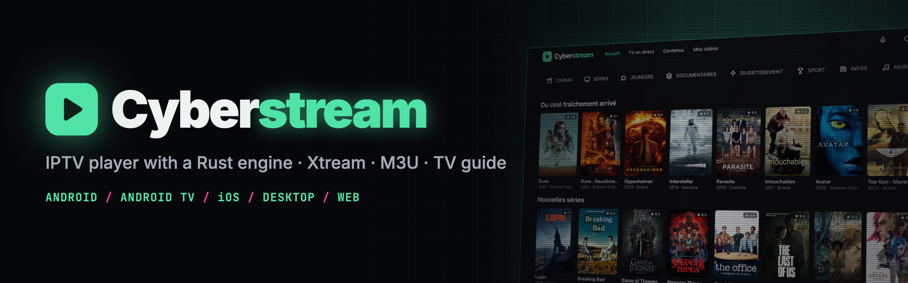

<p align="center">
  <a href="https://pickywawa.github.io/cyberstream/en/">
    
  </a>
</p>

<p align="center">
  <a href="https://github.com/pickywawa/cyberstream/releases/latest"></a>
  
  <a href="../../LICENSE"></a>
  
</p>

<p align="center">
  <b><a href="https://pickywawa.github.io/cyberstream/en/">Situs web</a></b> ·
  <b><a href="https://github.com/pickywawa/cyberstream/releases/latest">Unduh</a></b> ·
  <a href="#-fitur">Fitur</a> ·
  <a href="#-bahasa-dan-negara">Negara</a> ·
  <a href="#%EF%B8%8F-tangkapan-layar">Tangkapan layar</a> ·
  <a href="#%EF%B8%8F-build-dan-uji">Build</a>
  <br />
  <a href="../../README.md">English</a> · <a href="README.fr.md">Français</a> · <a href="README.es.md">Español</a> · <a href="README.de.md">Deutsch</a> · <a href="README.it.md">Italiano</a> · <a href="README.pt.md">Português</a> · <a href="README.ru.md">Русский</a> · <a href="README.zh.md">中文</a> · <a href="README.ja.md">日本語</a> · <a href="README.hi.md">हिन्दी</a> · <a href="README.bn.md">বাংলা</a> · <a href="README.ur.md">اردو</a> · <a href="README.ar.md">العربية</a> · <b>Bahasa Indonesia</b>
</p>

---

**Cyberstream** memutar sumber **Xtream Codes** dan **M3U** milikmu: saluran langsung, panduan TV, film, serial, dan siaran ulang. Aplikasi ini memindahkan pemutar IPTV CyberTV ke Rust: modul WebAssembly yang sama berjalan di browser, di ponsel dan TV Android, di iOS, dan di Electron. Android memakai Media3 untuk dekode video dan pemilihan trek.

> [!NOTE]
> Cyberstream adalah pemutar. Aplikasi ini tidak menyediakan konten apa pun: kamu memakai sumbermu sendiri.

<p align="center">
  
  <br />
  <sub>Direkam dengan sumber demo dan metadata TMDB. Antarmuka ditampilkan dalam bahasa Prancis.</sub>
</p>

## ⚡ Fitur

| | |
| --- | --- |
| 📡 **Xtream & M3U** | Katalog dibaca per bagian, server cadangan, sinkronisasi diferensial. |
| 🗓️ **Panduan XMLTV** | Kisi tervirtualisasi, garis “sekarang”, siaran ulang acara yang sudah lewat. |
| 🎬 **Film & serial** | Halaman yang diperkaya TMDB: pemeran, koleksi, rating usia, musim, lanjutkan menonton, episode berikutnya. |
| ⏸️ **Jeda siaran langsung** | Buffer lokal 30 hingga 60 menit, ±10 dtk, kembali ke siaran langsung, beralih otomatis ke stream cadangan. |
| 🎙️ **Perintah suara** | “Pindah ke saluran 5”, “cari Dune”, “mundur 30 detik”, dalam 14 bahasa antarmuka. |
| 📱 **Pengaturan lewat kode QR** | TV menerima profil, sumber, dan pengaturan dari ponselmu. |
| 🔁 **Siaran ulang gratis** | ARTE, france.tv, Okoo, ARD Mediathek, dan lebih dari 600 kanal YouTube media, sesuai negaramu. |
| 💬 **Subtitel & Trakt** | SRT, WebVTT, pencocokan hash OpenSubtitles, scrobbling dan watchlist Trakt. |
| 🌍 **14 bahasa, 42 negara** | Saluran gratis, panduan TV, radio, dan skor untuk setiap negara yang diikuti, beberapa negara per profil. |
| 👤 **Profil** | Avatar, bahasa, dan batas usia per profil. Token layanan tetap tersimpan di penyimpanan aman perangkat. |

## 🌍 Bahasa dan negara

**Antarmuka** dalam 14 bahasa: Prancis, Inggris, Jerman, Spanyol, Italia, Portugis, Arab, Hindi, Mandarin, Bengali, Indonesia, Urdu, Rusia, dan Jepang. Bahasa Arab dan Urdu ditampilkan dari kanan ke kiri. Perintah suara, tanggal, bahasa halaman TMDB, dan pengenalan suara mengikuti bahasa profil.

**Beberapa negara per profil.** Di profil, pilih satu atau beberapa negara (misalnya Indonesia dan Malaysia). Yang pertama adalah negara utama. Untuk setiap negara yang diikuti, aplikasi menambahkan:

- **Saluran gratis**: stream publik gratis yang terdaftar di [iptv-org](https://github.com/iptv-org/iptv), ditambahkan sebagai sumber. Opsi “Saluran gratis negaraku” ditawarkan saat membuat profil: aplikasi bisa dipakai tanpa langganan IPTV.
- **Panduan TV gratis**: [xmltvfr.fr](https://xmltvfr.fr) untuk Prancis, [epgshare01](https://epgshare01.online) untuk negara lain.
- **Siaran ulang**: france.tv dan Okoo (Prancis), ARD Mediathek (Jerman, Austria), ARTE (dalam enam bahasa, di Eropa).
- **YouTube**: kanal media negara tersebut per tema (berita, olahraga, dokumenter, komedi, media, radio). Semuanya sudah diperiksa: masing-masing menerbitkan lewat feed RSS publiknya.
- **Radio**: stasiun paling banyak didengar di negara tersebut, dari [Radio Browser](https://www.radio-browser.info). Semua negara tercakup.
- **Skor langsung**: liga-liga negara tersebut.

**Filter negara.** Opsi “Hanya saluran negaraku” menyaring, saat sumbermu diunduh, kategori saluran dari negara lain (“UK|”, “DE:”, “[BE]”…). Opsi ini ditawarkan saat menyiapkan sumber, sebelum unduhan pertama.

| Negara | Saluran gratis | Panduan TV | Siaran ulang | YouTube | Skor |
| --- | --- | --- | --- | --- | --- |
| 🇫🇷 Prancis | ≈231 (TF1, France 2, M6, Arte) | ya | france.tv, Okoo, ARTE | 21 (BFMTV, franceinfo…) | Ligue 1, Champions League, Premier League |
| 🇧🇪 Belgia | ≈60 (La Une, Tipik, RTL-TVI, BX1) | ya | ARTE | 10 (RTBF, RTBF Info…) | Pro League, Ligue 1, Champions League |
| 🇨🇭 Swiss | ≈137 (RTS, RSI, Couleur 3, 3sat) | ya | ARTE | 9 (RTS Info, Schweizer Radio und Fernsehen…) | Super League, Ligue 1, Bundesliga |
| 🇱🇺 Luksemburg | ≈20 (RTL, Eldo) | ya | ARTE | 2 (RTL Luxembourg, Wort…) | Ligue 1, Bundesliga, Champions League |
| 🇨🇦 Kanada | ≈265 (CBC, CTV, Télé-Québec) | ya | — | 14 (CBC News, CTV News…) | NHL, NBA, NFL |
| 🇲🇦 Maroko | ≈13 (2M, Al Aoula, Medi1) | — | — | 10 (2MTV, Hespress…) | AFCON, Ligue 1, LaLiga |
| 🇩🇿 Aljazair | ≈9 (Canal Algérie, Ennahar) | — | — | 7 (Ennahar Tv Plus, EchoroukTV…) | AFCON, Ligue 1, Champions League |
| 🇹🇳 Tunisia | ≈4 (Watania, Nessma) | — | — | 7 (Mosaique FM, Nessma TV…) | AFCON, Ligue 1, Champions League |
| 🇬🇧 Inggris Raya | ≈302 (BBC One, BBC News, Channel 4) | ya | ARTE | 30 (BBC News, Sky News…) | Premier League, Champions League |
| 🇮🇪 Irlandia | ≈58 (RTÉ News, Virgin Media) | ya | ARTE | 9 (RTÉ News, The Irish Times…) | Premier Division, Premier League, Champions League |
| 🇺🇸 Amerika Serikat | ≈1538 (PBS, ABC News, CBS News) | ya | — | 41 (CNN, NBC News…) | NFL, NBA, NHL |
| 🇦🇺 Australia | ≈78 (ABC, 7, 9) | ya | — | 11 (9 News Australia, SBS News…) | AFL, A-League, Premier League |
| 🇳🇿 Selandia Baru | ≈36 (TVNZ, Whakaata Māori) | ya | — | 6 (RNZ, 1News…) | A-League, Premier League |
| 🇩🇪 Jerman | ≈303 (Das Erste, ZDF, 3sat, tagesschau24) | ya | ARD Mediathek, ARTE | 28 (tagesschau, ZDFheute Nachrichten…) | Bundesliga, Champions League |
| 🇦🇹 Austria | ≈114 (ORF, ServusTV, PULS 24) | ya | ARD Mediathek, ARTE | 9 (PULS 24, Kronen Zeitung…) | Bundesliga (AT), Bundesliga, Champions League |
| 🇪🇸 Spanyol | ≈305 (3Cat, À Punt, 24 Horas, Atreseries) | ya | ARTE | 27 (Antena 3 Noticias, EL PAÍS…) | LaLiga, Champions League, NBA |
| 🇲🇽 Meksiko | ≈179 (Canal 22, Canal Once, Azteca) | ya | — | 12 (NMás, MILENIO…) | Liga MX, Concacaf, LaLiga |
| 🇦🇷 Argentina | ≈224 (Telefe, TN, A24) | ya | — | 11 (C5N, LA NACION…) | Liga Profesional, Libertadores, LaLiga |
| 🇨🇴 Kolombia | ≈171 (Canal Capital, Señal Colombia) | ya | — | 7 (Noticias Caracol, Noticias RCN…) | Primera A, Libertadores, LaLiga |
| 🇨🇱 Cile | ≈220 (TVN, 24 Horas, T13) | ya | — | 9 (Teletrece, CHV Noticias…) | Primera División, Libertadores, LaLiga |
| 🇮🇹 Italia | ≈359 (Rai 1, Rai 2, Rai 3, Rai News 24) | ya | ARTE | 21 (RaiNews, Sky tg24…) | Serie A, Champions League |
| 🇵🇹 Portugal | ≈72 (RTP 1, RTP 2, RTP Notícias, SIC) | ya | — | 10 (RTP Notícias, TVI…) | Liga Portugal, Champions League |
| 🇧🇷 Brasil | ≈401 (TV Cultura, Record News, SBT) | ya | — | 23 (g1, CNN Brasil…) | Brasileirão, Libertadores, NBA |
| 🇳🇱 Belanda | ≈175 (NPO, AT5) | ya | — | 11 (NOS, RTL Nieuws…) | Eredivisie, Champions League |
| 🇹🇷 Turki | ≈180 (TRT 1, TRT Haber, NTV) | ya | — | 8 (TRT Haber, CNN TÜRK…) | Süper Lig, Champions League |
| 🇵🇱 Polandia | ≈188 (TVP Info, TVP World) | ya | ARTE | 12 (tvn24, Polsat…) | Champions League |
| 🇷🇺 Rusia | ≈518 (2x2, 360°, RT) | — | — | 19 (Телеканал Дождь, BBC News - Русская служба…) | RPL |
| 🇸🇦 Arab Saudi | ≈56 (Al Saudiya, Al Ekhbariya, Asharq News) | ya | — | 17 (AlArabiya العربية, سكاي نيوز عربية…) | Saudi Pro League, AFC Champions League, Premier League |
| 🇦🇪 Uni Emirat Arab | ≈23 (Dubai TV, Abu Dhabi TV) | ya | — | 10 (سكاي نيوز عربية, AlArabiya العربية…) | AFC Champions League, Premier League, LaLiga |
| 🇶🇦 Qatar | ≈10 (Al Jazeera, Al Rayyan) | — | — | 4 (Al Jazeera English, العربي - أخبار…) | AFC Champions League, Premier League, LaLiga |
| 🇪🇬 Mesir | ≈21 (Nile Drama, MBC Masr, Al Ghad) | — | — | 11 (CBC Egypt, Sada Elbalad - صدى البلد…) | AFCON, Premier League, LaLiga |
| 🇮🇳 India | ≈826 (DD National, DD News, Aaj Tak, NDTV) | ya | — | 30 (Aaj Tak, NDTV…) | ISL, Premier League |
| 🇵🇰 Pakistan | ≈105 (PTV, ARY News, Dunya News) | — | — | 19 (Geo News, ARY News…) | Premier League |
| 🇧🇩 Bangladesh | ≈37 (ATN Bangla, NTV, T Sports, Ekhon) | — | — | 17 (SOMOY TV, Jamuna TV Plus…) | Premier League |
| 🇮🇩 Indonesia | ≈177 (TVRI, Kompas TV, Metro TV) | ya | — | 28 (CNN Indonesia, tvOneNews…) | Super League, Premier League |
| 🇲🇾 Malaysia | ≈6 (TV1, TV2) | ya | — | 6 (Astro AWANI, Berita Harian Online…) | Super League, Premier League |
| 🇸🇬 Singapura | ≈9 (CNA) | ya | — | 5 (CNA Insider, CNA…) | Premier League |
| 🇨🇳 Tiongkok | ≈156 (CCTV-1, CCTV-4, CCTV-13) | — | — | 11 (CGTN, CCTV Video News Agency…) | CSL, NBA |
| 🇹🇼 Taiwan | ≈34 (PTS, TTV) | — | — | 10 (TVBS NEWS, SETN News Network…) | NBA, MLB |
| 🇭🇰 Hong Kong | ≈18 (RTHK, TVB) | ya | — | 7 (TVB NEWS Official 無綫新聞, RTHK 香港電台…) | Premier League, NBA |
| 🇯🇵 Jepang | ≈17 (NHK General, Nippon TV, TV Asahi, Fuji TV) | ya | — | 22 (ANNnewsCH, TBS NEWS DIG Powered by JNN…) | J1 League, MLB |
| 🇰🇷 Korea Selatan | ≈72 (KBS, MBC, Arirang) | — | — | 16 (YTN, SBS News…) | MLB, Premier League |

Jumlah saluran gratis berasal dari daftar iptv-org pada saat penulisan. Sebagian stream ini hanya berfungsi di negaranya sendiri atau sering berubah. Sebagian video ARD hanya bisa ditonton di Jerman, Austria, dan Swiss.

**Layanan yang tidak disertakan.** BBC iPlayer, ITVX, dan Channel 4 membutuhkan akun dan koneksi dari Inggris, serta lisensi TV untuk iPlayer. PBS berjalan lewat aplikasi dan akun masing-masing stasiun. RTVE Play melindungi videonya dengan DRM. RaiPlay membatasi sebagian besar katalognya untuk Italia, sering kali dengan login. Saluran langsung mereka muncul di antara saluran gratis jika disiarkan gratis, dan kanal YouTube mereka ada di siaran ulang.

## 🖼️ Tangkapan layar

<table>
  <tr>
    <td width="50%"><p align="center"><sub>Beranda</sub></p></td>
    <td width="50%"><p align="center"><sub>TV langsung</sub></p></td>
  </tr>
  <tr>
    <td><p align="center"><sub>Panduan TV</sub></p></td>
    <td><p align="center"><sub>Halaman film</sub></p></td>
  </tr>
  <tr>
    <td><p align="center"><sub>Serial</sub></p></td>
    <td><p align="center"><sub>Pemutar — stream uji <i>Big Buck Bunny</i> © Blender Foundation, CC BY</sub></p></td>
  </tr>
</table>

<p align="center">
  
  &nbsp;
  
  &nbsp;
  
</p>

## 📦 Instalasi

Unduh `Cyberstream-x.y.z.apk` dari [rilis terbaru](https://github.com/pickywawa/cyberstream/releases/latest), lalu pasang di ponsel atau TV-mu:

```sh
adb -d install -r Cyberstream-1.0.1.apk
```

Paket Android-nya adalah `app.cyberstream.player`. APK yang sama bisa dipasang di ponsel dan muncul di launcher Android TV. Minimum yang dinyatakan adalah Android 7 (API 24). Antarmuka membutuhkan WebView yang mendukung WebAssembly dan modul JavaScript; versi sistem saja tidak menjaminnya.

## 🦀 Status porting

Pra-rilis ini mengikuti CyberTV 0.16.0. Porting-nya masih hibrida.

| Fitur | Implementasi di versi ini |
| --- | --- |
| Sumber Xtream dan M3U | Rust membaca katalog per bagian, mengurutkan entri, dan menyusun URL pemutaran dan siaran ulang. Worker TypeScript mengatur permintaan, server cadangan, unduhan latar belakang, dan transaksi IndexedDB. |
| Panduan XMLTV | Rust mengekstrak gzip, membaca acara, menangani zona waktu, dan menggambar sel kisi yang terlihat. IndexedDB menjaga jadwal sebelumnya tetap tersedia selama impor. |
| Pencarian dan pengurutan | Rust mengindeks judul, mengurutkan saluran, mendeteksi bahasa, dan memulihkan indeks katalog dari halaman yang dikompresi LZ4. |
| Film dan serial | Rust membaca episode Xtream dan metadata TMDB, termasuk rating usia, pemeran, dan koleksi. Rust menggambar header halaman, musim, episode, pustaka, dan kartu. Pemilihan trek dan keputusan lompat di dalam stream juga memakai Rust. |
| Siaran ulang dan subtitel | Rust menangani katalog dan stream ARTE dan france.tv, feed RSS YouTube, SRT dan WebVTT, serta hash OpenSubtitles. |
| Antarmuka dan remote | Menu utama, ubin profil, terjemahan, navigasi arah, virtualisasi, dan perintah suara memakai Rust. Klien Trakt, pengurutan OpenSubtitles, dan validasi pertukaran kode QR juga. Beranda, kisi, hasil pencarian, dan halaman Replay memiliki tampilan Rust. React dan TypeScript memasang layar, menangani event, dan beberapa integrasi layanan. |
| Fitur perangkat | Android mempertahankan jembatan Java untuk Media3, cache, timeshift, penyimpanan aman, dan pemasangan TV. Host iOS memakai Swift dan host desktop memakai Electron. |

Layar CyberTV dipertahankan agar alur penggunaan tetap sama selama migrasi. Kesetaraan penuh di Android TV, iOS, dan desktop masih perlu diuji. Spesifikasi aslinya ada di [docs/SPECIFICATIONS.md](../SPECIFICATIONS.md) (dalam bahasa Prancis).

## 🛠️ Build dan uji

Kebutuhan untuk web dan uji lokal: Rust stabil dengan target WebAssembly, Node.js 22.12 atau lebih baru, dan npm. Generator binding harus sesuai dengan versi crate.

```sh
rustup target add wasm32-unknown-unknown
cargo install --locked wasm-bindgen-cli --version 0.2.108
npm ci
cargo test --locked
npm test
npm run build
```

Dengan Android SDK 36, JDK 21, serta `JAVA_HOME` dan `ANDROID_HOME` yang sudah diatur:

```sh
npm run android:apk
adb -d install -r android/app/build/outputs/apk/debug/app-debug.apk
```

Profil dan sumber diatur di perangkat. Untuk mencoba versi web dengan data tiruan, jalankan `npm run dev -- --host 127.0.0.1` lalu pilih sumber demo saat penyiapan. Kunci layanan opsional dimasukkan di pengaturan profil. Sejak versi 0.16.3, pemutar memeriksa rilis GitHub Cyberstream, termasuk pra-rilis. Setiap rilis Android harus melampirkan manifes `update.json`-nya dan APK yang dirujuknya. Untuk menguji kanal lain, atur `CYBER_UPDATE_URL` ke URL manifes saat build. Pengguna versi 0.16.1 dan 0.16.2 harus memasang APK yang lebih baru secara manual satu kali.

## 📺 Sumber daya di Android TV

Kisi katalog menyimpan ID yang sudah diurutkan dan memuat poster baris demi baris sesuai baris yang terlihat. Unduhan pertama memilih kategori dalam bahasa audio profil, dengan opsi untuk mempertahankan semua bahasa.

Sidik jari entri Xtream mempertahankan baris yang tidak berubah di antara dua sinkronisasi. Panduan juga mempertahankan ID slot yang stabil dan menulis ulang acara yang berubah.

Ikon launcher dan antarmuka adalah gambar vektor. Android menyimpan SVG dan animasi yang diterima dan mengubah ukuran foto sesuai penggunaannya. Sisi maksimum adalah 224 piksel untuk logo, 448 untuk kartu, dan 1.024 untuk gambar utama. Dua dekode gambar dapat berjalan bersamaan. Cache disk menargetkan 96 MiB dengan penghapusan berkala berkas yang paling lama tidak dipakai.

Mode performa aktif secara bawaan di Android. Beranda membaca sampel film yang terbatas. Dalam mode ini, pencarian membangun indeksnya sesuai kebutuhan. Pada perangkat yang ditandai bermemori rendah, pemutar menargetkan buffer media 24 MiB. Batas-batas ini membatasi subsistem tertentu. Total memori, waktu mulai, dan kelancaran harus diukur di TV tujuan.

## 🌐 Situs web

Situs web ada di [`docs/`](../) (HTML, CSS, dan JS biasa, tanpa langkah build), dalam bahasa Prancis di root dan bahasa Inggris di `docs/en/`. Situs ini diterbitkan dengan GitHub Pages dari branch `main`, folder `/docs`. Pratinjau lokal:

```sh
python3 -m http.server 8090 -d docs
```

## 📄 Lisensi

Kode dirilis di bawah lisensi [MIT](../../LICENSE).

---

<p align="center"><sub>Poster, foto, dan metadata: <a href="https://www.themoviedb.org/">TMDB</a>. Produk ini memakai API TMDB tetapi tidak didukung atau disertifikasi oleh TMDB. Logo saluran dan daftar saluran gratis: <a href="https://github.com/iptv-org">iptv-org</a>; merek dagang dan karya seni milik pemiliknya masing-masing. Panduan TV: xmltvfr.fr dan epgshare01. Radio: Radio Browser. Video pemutar: stream uji <i>Big Buck Bunny</i> © Blender Foundation, CC BY 3.0.</sub></p>
