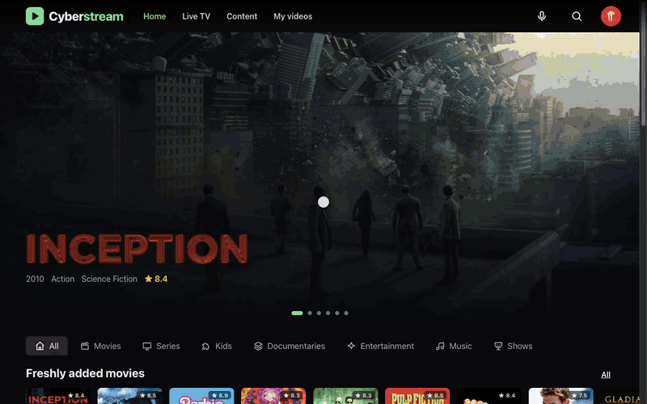
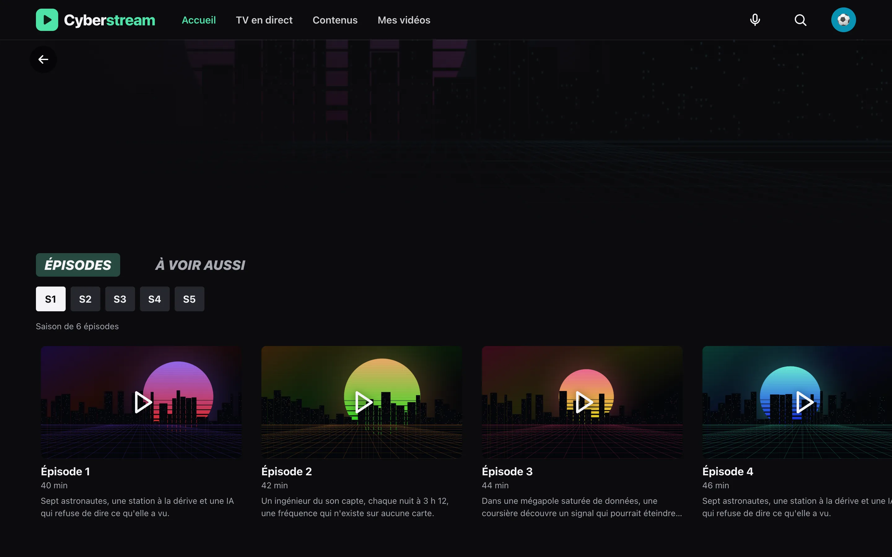
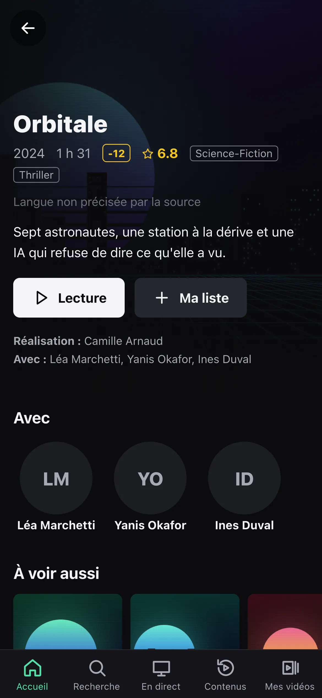

<p align="center">
  <a href="https://pickywawa.github.io/cyberstream/en/">
    
  </a>
</p>

<p align="center">
  <a href="https://github.com/pickywawa/cyberstream/releases/latest"></a>
  
  <a href="../../LICENSE"></a>
  
</p>

<p align="center">
  <b><a href="https://pickywawa.github.io/cyberstream/en/">Sito</a></b> ·
  <b><a href="https://github.com/pickywawa/cyberstream/releases/latest">Scarica</a></b> ·
  <a href="#-funzioni">Funzioni</a> ·
  <a href="#-lingue-e-paesi">Paesi</a> ·
  <a href="#%EF%B8%8F-schermate">Schermate</a> ·
  <a href="#%EF%B8%8F-compilare-e-testare">Compilare</a>
  <br />
  <a href="../../README.md">English</a> · <a href="README.fr.md">Français</a> · <a href="README.es.md">Español</a> · <a href="README.de.md">Deutsch</a> · <b>Italiano</b> · <a href="README.pt.md">Português</a> · <a href="README.ru.md">Русский</a> · <a href="README.zh.md">中文</a> · <a href="README.ja.md">日本語</a> · <a href="README.hi.md">हिन्दी</a> · <a href="README.bn.md">বাংলা</a> · <a href="README.ur.md">اردو</a> · <a href="README.ar.md">العربية</a> · <a href="README.id.md">Bahasa Indonesia</a>
</p>

---

**Cyberstream** riproduce le tue sorgenti **Xtream Codes** e **M3U**: canali in diretta, guida TV, film, serie e replay. Porta il lettore IPTV CyberTV in Rust: lo stesso modulo WebAssembly gira nel browser, su smartphone e TV Android, su iOS e in Electron. Android usa Media3 per la decodifica video e la scelta delle tracce.

> [!NOTE]
> Cyberstream è un lettore. Non fornisce alcun contenuto: usi le tue sorgenti.

<p align="center">
  
  <br />
  <sub>Registrato con la sorgente demo e i metadati TMDB. L'interfaccia è mostrata in inglese.</sub>
</p>

## ⚡ Funzioni

| | |
| --- | --- |
| 📡 **Xtream e M3U** | Cataloghi letti a blocchi, server di riserva, sincronizzazione differenziale. |
| 🗓️ **Guida XMLTV** | Griglia virtualizzata, linea «adesso», replay dei programmi passati. |
| 🎬 **Film e serie** | Schede arricchite da TMDB: cast, collezioni, classificazione per età, stagioni, ripresa, episodio successivo. |
| ⏸️ **Pausa in diretta** | Buffer locale da 30 a 60 min, ±10 s, ritorno alla diretta, passaggio automatico a un flusso di riserva. |
| 🎙️ **Comandi vocali** | «Metti il canale 5», «cerca Dune», «torna indietro di 30 secondi», nelle 14 lingue dell'interfaccia. |
| 📱 **Configurazione con QR code** | La TV riceve profilo, sorgenti e impostazioni dal tuo telefono. |
| 🔁 **Replay gratuito** | ARTE, france.tv, Okoo, ARD Mediathek e oltre 600 canali YouTube di testate, secondo i tuoi paesi. |
| 💬 **Sottotitoli e Trakt** | SRT, WebVTT, corrispondenza tramite hash OpenSubtitles, scrobbling e watchlist Trakt. |
| 🌍 **14 lingue, 42 paesi** | Canali gratuiti, guida TV, radio e risultati per ogni paese seguito, più paesi per profilo. |
| 👤 **Profili** | Avatar, lingua e limite di età per profilo. I token dei servizi restano nell'archivio sicuro del dispositivo. |

## 🌍 Lingue e paesi

**Interfaccia** in 14 lingue: francese, inglese, tedesco, spagnolo, italiano, portoghese, arabo, hindi, cinese, bengalese, indonesiano, urdu, russo e giapponese. L'arabo e l'urdu sono mostrati da destra a sinistra. I comandi vocali, le date, la lingua delle schede TMDB e il riconoscimento vocale seguono la lingua del profilo.

**Più paesi per profilo.** Nel profilo, scegli uno o più paesi (per esempio Italia e Svizzera). Il primo è il paese principale. Per ogni paese seguito, l'app aggiunge:

- **Canali gratuiti**: i flussi pubblici gratuiti elencati da [iptv-org](https://github.com/iptv-org/iptv), aggiunti come sorgente. L'opzione «Canali gratuiti dei miei paesi» viene proposta alla creazione del profilo: l'app funziona senza abbonamento IPTV.
- **Guida TV gratuita**: [xmltvfr.fr](https://xmltvfr.fr) per la Francia, [epgshare01](https://epgshare01.online) per gli altri paesi.
- **Replay**: france.tv e Okoo (Francia), ARD Mediathek (Germania, Austria), ARTE (in sei lingue, in Europa).
- **YouTube**: i canali delle testate del paese per tema (notizie, sport, documentari, comicità, media, radio). Sono stati tutti verificati: ognuno pubblica tramite il proprio feed RSS pubblico.
- **Radio**: le stazioni più ascoltate del paese, da [Radio Browser](https://www.radio-browser.info). Tutti i paesi sono coperti.
- **Risultati in diretta**: i campionati del paese.

**Filtro per paese.** L'opzione «Solo i canali dei miei paesi» esclude, al download della sorgente, le categorie di canali di altri paesi («UK|», «DE:», «[BE]»…). Viene proposta durante la configurazione della sorgente, prima del primo download.

| Paese | Canali gratuiti | Guida TV | Replay | YouTube | Risultati |
| --- | --- | --- | --- | --- | --- |
| 🇫🇷 Francia | ≈231 (TF1, France 2, M6, Arte) | sì | france.tv, Okoo, ARTE | 21 (BFMTV, franceinfo…) | Ligue 1, Champions League, Premier League |
| 🇧🇪 Belgio | ≈60 (La Une, Tipik, RTL-TVI, BX1) | sì | ARTE | 10 (RTBF, RTBF Info…) | Pro League, Ligue 1, Champions League |
| 🇨🇭 Svizzera | ≈137 (RTS, RSI, Couleur 3, 3sat) | sì | ARTE | 9 (RTS Info, Schweizer Radio und Fernsehen…) | Super League, Ligue 1, Bundesliga |
| 🇱🇺 Lussemburgo | ≈20 (RTL, Eldo) | sì | ARTE | 2 (RTL Luxembourg, Wort…) | Ligue 1, Bundesliga, Champions League |
| 🇨🇦 Canada | ≈265 (CBC, CTV, Télé-Québec) | sì | — | 14 (CBC News, CTV News…) | NHL, NBA, NFL |
| 🇲🇦 Marocco | ≈13 (2M, Al Aoula, Medi1) | — | — | 10 (2MTV, Hespress…) | AFCON, Ligue 1, LaLiga |
| 🇩🇿 Algeria | ≈9 (Canal Algérie, Ennahar) | — | — | 7 (Ennahar Tv Plus, EchoroukTV…) | AFCON, Ligue 1, Champions League |
| 🇹🇳 Tunisia | ≈4 (Watania, Nessma) | — | — | 7 (Mosaique FM, Nessma TV…) | AFCON, Ligue 1, Champions League |
| 🇬🇧 Regno Unito | ≈302 (BBC One, BBC News, Channel 4) | sì | ARTE | 30 (BBC News, Sky News…) | Premier League, Champions League |
| 🇮🇪 Irlanda | ≈58 (RTÉ News, Virgin Media) | sì | ARTE | 9 (RTÉ News, The Irish Times…) | Premier Division, Premier League, Champions League |
| 🇺🇸 Stati Uniti | ≈1538 (PBS, ABC News, CBS News) | sì | — | 41 (CNN, NBC News…) | NFL, NBA, NHL |
| 🇦🇺 Australia | ≈78 (ABC, 7, 9) | sì | — | 11 (9 News Australia, SBS News…) | AFL, A-League, Premier League |
| 🇳🇿 Nuova Zelanda | ≈36 (TVNZ, Whakaata Māori) | sì | — | 6 (RNZ, 1News…) | A-League, Premier League |
| 🇩🇪 Germania | ≈303 (Das Erste, ZDF, 3sat, tagesschau24) | sì | ARD Mediathek, ARTE | 28 (tagesschau, ZDFheute Nachrichten…) | Bundesliga, Champions League |
| 🇦🇹 Austria | ≈114 (ORF, ServusTV, PULS 24) | sì | ARD Mediathek, ARTE | 9 (PULS 24, Kronen Zeitung…) | Bundesliga (AT), Bundesliga, Champions League |
| 🇪🇸 Spagna | ≈305 (3Cat, À Punt, 24 Horas, Atreseries) | sì | ARTE | 27 (Antena 3 Noticias, EL PAÍS…) | LaLiga, Champions League, NBA |
| 🇲🇽 Messico | ≈179 (Canal 22, Canal Once, Azteca) | sì | — | 12 (NMás, MILENIO…) | Liga MX, Concacaf, LaLiga |
| 🇦🇷 Argentina | ≈224 (Telefe, TN, A24) | sì | — | 11 (C5N, LA NACION…) | Liga Profesional, Libertadores, LaLiga |
| 🇨🇴 Colombia | ≈171 (Canal Capital, Señal Colombia) | sì | — | 7 (Noticias Caracol, Noticias RCN…) | Primera A, Libertadores, LaLiga |
| 🇨🇱 Cile | ≈220 (TVN, 24 Horas, T13) | sì | — | 9 (Teletrece, CHV Noticias…) | Primera División, Libertadores, LaLiga |
| 🇮🇹 Italia | ≈359 (Rai 1, Rai 2, Rai 3, Rai News 24) | sì | ARTE | 21 (RaiNews, Sky tg24…) | Serie A, Champions League |
| 🇵🇹 Portogallo | ≈72 (RTP 1, RTP 2, RTP Notícias, SIC) | sì | — | 10 (RTP Notícias, TVI…) | Liga Portugal, Champions League |
| 🇧🇷 Brasile | ≈401 (TV Cultura, Record News, SBT) | sì | — | 23 (g1, CNN Brasil…) | Brasileirão, Libertadores, NBA |
| 🇳🇱 Paesi Bassi | ≈175 (NPO, AT5) | sì | — | 11 (NOS, RTL Nieuws…) | Eredivisie, Champions League |
| 🇹🇷 Turchia | ≈180 (TRT 1, TRT Haber, NTV) | sì | — | 8 (TRT Haber, CNN TÜRK…) | Süper Lig, Champions League |
| 🇵🇱 Polonia | ≈188 (TVP Info, TVP World) | sì | ARTE | 12 (tvn24, Polsat…) | Champions League |
| 🇷🇺 Russia | ≈518 (2x2, 360°, RT) | — | — | 19 (Телеканал Дождь, BBC News - Русская служба…) | RPL |
| 🇸🇦 Arabia Saudita | ≈56 (Al Saudiya, Al Ekhbariya, Asharq News) | sì | — | 17 (AlArabiya العربية, سكاي نيوز عربية…) | Saudi Pro League, AFC Champions League, Premier League |
| 🇦🇪 Emirati Arabi Uniti | ≈23 (Dubai TV, Abu Dhabi TV) | sì | — | 10 (سكاي نيوز عربية, AlArabiya العربية…) | AFC Champions League, Premier League, LaLiga |
| 🇶🇦 Qatar | ≈10 (Al Jazeera, Al Rayyan) | — | — | 4 (Al Jazeera English, العربي - أخبار…) | AFC Champions League, Premier League, LaLiga |
| 🇪🇬 Egitto | ≈21 (Nile Drama, MBC Masr, Al Ghad) | — | — | 11 (CBC Egypt, Sada Elbalad - صدى البلد…) | AFCON, Premier League, LaLiga |
| 🇮🇳 India | ≈826 (DD National, DD News, Aaj Tak, NDTV) | sì | — | 30 (Aaj Tak, NDTV…) | ISL, Premier League |
| 🇵🇰 Pakistan | ≈105 (PTV, ARY News, Dunya News) | — | — | 19 (Geo News, ARY News…) | Premier League |
| 🇧🇩 Bangladesh | ≈37 (ATN Bangla, NTV, T Sports, Ekhon) | — | — | 17 (SOMOY TV, Jamuna TV Plus…) | Premier League |
| 🇮🇩 Indonesia | ≈177 (TVRI, Kompas TV, Metro TV) | sì | — | 28 (CNN Indonesia, tvOneNews…) | Super League, Premier League |
| 🇲🇾 Malaysia | ≈6 (TV1, TV2) | sì | — | 6 (Astro AWANI, Berita Harian Online…) | Super League, Premier League |
| 🇸🇬 Singapore | ≈9 (CNA) | sì | — | 5 (CNA Insider, CNA…) | Premier League |
| 🇨🇳 Cina | ≈156 (CCTV-1, CCTV-4, CCTV-13) | — | — | 11 (CGTN, CCTV Video News Agency…) | CSL, NBA |
| 🇹🇼 Taiwan | ≈34 (PTS, TTV) | — | — | 10 (TVBS NEWS, SETN News Network…) | NBA, MLB |
| 🇭🇰 Hong Kong | ≈18 (RTHK, TVB) | sì | — | 7 (TVB NEWS Official 無綫新聞, RTHK 香港電台…) | Premier League, NBA |
| 🇯🇵 Giappone | ≈17 (NHK General, Nippon TV, TV Asahi, Fuji TV) | sì | — | 22 (ANNnewsCH, TBS NEWS DIG Powered by JNN…) | J1 League, MLB |
| 🇰🇷 Corea del Sud | ≈72 (KBS, MBC, Arirang) | — | — | 16 (YTN, SBS News…) | MLB, Premier League |

Il numero di canali gratuiti proviene dagli elenchi di iptv-org al momento della stesura. Alcuni di questi flussi funzionano solo nel proprio paese o cambiano spesso. Alcuni video ARD sono visibili solo in Germania, Austria e Svizzera.

**Servizi non inclusi.** BBC iPlayer, ITVX e Channel 4 richiedono un account e una connessione dal Regno Unito, oltre a un canone TV per iPlayer. PBS passa dall'app e dall'account di ogni emittente. RTVE Play protegge i suoi video con DRM. RaiPlay riserva gran parte del catalogo all'Italia, spesso con accesso. I loro canali in diretta compaiono tra i canali gratuiti quando sono trasmessi in chiaro, e i loro canali YouTube sono nel replay.

## 🖼️ Schermate

<table>
  <tr>
    <td width="50%"><p align="center"><sub>Home</sub></p></td>
    <td width="50%"><p align="center"><sub>TV in diretta</sub></p></td>
  </tr>
  <tr>
    <td><p align="center"><sub>Guida TV</sub></p></td>
    <td><p align="center"><sub>Scheda film</sub></p></td>
  </tr>
  <tr>
    <td><p align="center"><sub>Serie</sub></p></td>
    <td><p align="center"><sub>Lettore — flusso di prova <i>Big Buck Bunny</i> © Blender Foundation, CC BY</sub></p></td>
  </tr>
</table>

<p align="center">
  
  &nbsp;
  
  &nbsp;
  
</p>

## 📦 Installazione

Scarica `Cyberstream-x.y.z.apk` dall'[ultima versione](https://github.com/pickywawa/cyberstream/releases/latest), poi installalo sul telefono o sulla TV:

```sh
adb -d install -r Cyberstream-1.0.1.apk
```

Il pacchetto Android è `app.cyberstream.player`. Lo stesso APK si installa sugli smartphone e compare nel launcher di Android TV. Il minimo dichiarato è Android 7 (API 24). L'interfaccia richiede un WebView che supporti WebAssembly e i moduli JavaScript; la sola versione del sistema non lo garantisce.

## 🦀 Stato del porting

La pre-release segue CyberTV 0.16.0. Il porting è ancora ibrido.

| Funzione | Implementazione in questa versione |
| --- | --- |
| Sorgenti Xtream e M3U | Rust legge i cataloghi a blocchi, ordina le voci e costruisce gli URL di riproduzione e replay. Il worker TypeScript orchestra richieste, server di riserva, download in background e transazioni IndexedDB. |
| Guida XMLTV | Rust decomprime gzip, legge i programmi, gestisce i fusi orari e disegna le celle visibili della griglia. IndexedDB mantiene disponibile il palinsesto precedente durante un'importazione. |
| Ricerca e ordinamento | Rust indicizza i titoli, ordina i canali, rileva le lingue e ripristina l'indice del catalogo da pagine compresse LZ4. |
| Film e serie | Rust legge gli episodi Xtream e i metadati TMDB, incluse classificazioni per età, cast e collezioni. Rust disegna intestazioni delle schede, stagioni, episodi, la libreria e le card. Anche la scelta delle tracce e le decisioni di salto nel flusso usano Rust. |
| Replay e sottotitoli | Rust gestisce cataloghi e flussi di ARTE e france.tv, i feed RSS di YouTube, SRT e WebVTT e l'hash OpenSubtitles. |
| Interfaccia e telecomando | Menu principali, riquadri dei profili, traduzioni, navigazione direzionale, virtualizzazione e comandi vocali usano Rust. Anche il client Trakt, l'ordinamento OpenSubtitles e la validazione dello scambio tramite QR code. Home, griglie, risultati di ricerca e pagine Replay hanno viste Rust. React e TypeScript montano le schermate, gestiscono gli eventi e diverse integrazioni di servizi. |
| Funzioni del dispositivo | Android mantiene bridge Java per Media3, cache, timeshift, archivio sicuro e abbinamento TV. L'host iOS usa Swift e quello desktop Electron. |

Le schermate di CyberTV sono state riprese per mantenere i percorsi d'uso durante la migrazione. La parità completa su Android TV, iOS e desktop è ancora da testare. Le specifiche originali sono in [docs/SPECIFICATIONS.md](../SPECIFICATIONS.md) (in francese).

## 🛠️ Compilare e testare

Requisiti per il web e i test locali: Rust stabile con il target WebAssembly, Node.js 22.12 o successivo e npm. Il generatore di binding deve corrispondere alla versione del crate.

```sh
rustup target add wasm32-unknown-unknown
cargo install --locked wasm-bindgen-cli --version 0.2.108
npm ci
cargo test --locked
npm test
npm run build
```

Con Android SDK 36, JDK 21, `JAVA_HOME` e `ANDROID_HOME` impostati:

```sh
npm run android:apk
adb -d install -r android/app/build/outputs/apk/debug/app-debug.apk
```

Profilo e sorgenti si configurano sul dispositivo. Per provare la versione web con dati fittizi, esegui `npm run dev -- --host 127.0.0.1` e scegli la sorgente demo durante la configurazione. Le chiavi dei servizi opzionali vanno nelle impostazioni del profilo. Dalla versione 0.16.3, il lettore controlla le release GitHub di Cyberstream, pre-release incluse. Ogni release Android deve allegare il proprio manifest `update.json` e l'APK a cui fa riferimento. Per testare un altro canale, imposta `CYBER_UPDATE_URL` sull'URL di un manifest in fase di build. Gli utenti delle versioni 0.16.1 e 0.16.2 devono installare manualmente, una volta, un APK più recente.

## 📺 Risorse su Android TV

La griglia del catalogo conserva ID ordinati e carica le locandine riga per riga in base alle righe visibili. Il primo download seleziona le categorie nelle lingue audio del profilo, con un'opzione per mantenere tutte le lingue.

Un'impronta delle voci Xtream conserva le righe invariate tra due sincronizzazioni. Anche la guida mantiene ID di fascia stabili e riscrive i programmi modificati.

Le icone del launcher e dell'interfaccia sono disegni vettoriali. Android conserva gli SVG e le animazioni ricevuti e ridimensiona le foto in base all'uso. Il lato massimo è di 224 pixel per un logo, 448 per una card e 1.024 per un'immagine di copertina. Possono essere eseguite due decodifiche di immagini contemporaneamente. La cache su disco punta a 96 MiB con rimozione periodica dei file usati meno di recente.

La modalità prestazioni è attiva per impostazione predefinita su Android. La home legge un campione limitato di film. In questa modalità la ricerca costruisce il proprio indice su richiesta. Su un dispositivo segnalato come a bassa memoria, il lettore punta a un buffer multimediale di 24 MiB. Questi limiti riguardano sottosistemi specifici. Memoria totale, tempo di avvio e fluidità vanno misurati sulla TV di destinazione.

## 🌐 Sito

Il sito si trova in [`docs/`](../) (HTML, CSS e JS semplici, senza fase di build), in francese nella radice e in inglese in `docs/en/`. È pubblicato con GitHub Pages dal branch `main`, cartella `/docs`. Anteprima locale:

```sh
python3 -m http.server 8090 -d docs
```

## 📄 Licenza

Codice pubblicato con licenza [MIT](../../LICENSE).

---

<p align="center"><sub>Locandine, foto e metadati: <a href="https://www.themoviedb.org/">TMDB</a>. Questo prodotto usa l'API di TMDB ma non è approvato né certificato da TMDB. Loghi dei canali ed elenchi dei canali gratuiti: <a href="https://github.com/iptv-org">iptv-org</a>; marchi e grafiche appartengono ai rispettivi proprietari. Guide TV: xmltvfr.fr ed epgshare01. Radio: Radio Browser. Video del lettore: flusso di prova <i>Big Buck Bunny</i> © Blender Foundation, CC BY 3.0.</sub></p>
